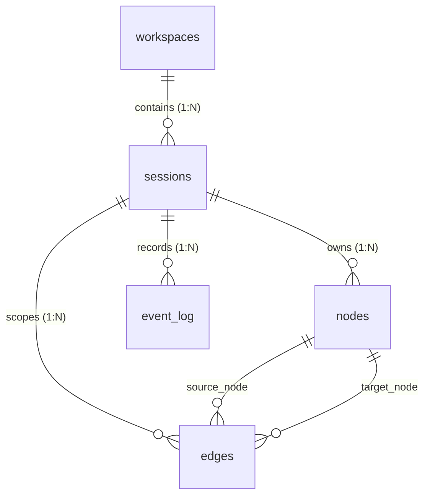

# CyGuide Database Architecture & Storage Specification

Welcome to the developer database specification for CyGuide.

> [!NOTE]
> The primary authoritative database architecture document is maintained in [`docs/developer/DATABASE.md`](docs/developer/DATABASE.md).

For the complete in-depth guide covering the relational schema, entity graph models, Primary Identity Keys (PIK), auto-wiring mechanics, export/import subsystem, and query recipes, please see:

👉 **[Complete Database Documentation (`docs/developer/DATABASE.md`)](docs/developer/DATABASE.md)**

---

## Quick Reference Summary

### Core Relational Tables
* **`workspaces`**: Top-level project/engagement metadata container (`id`, `name`, `status`, `created_at`).
* **`sessions`**: Investigation-scoped sessions under workspaces (`id`, `workspace_id`, `name`, `status`, `created_at`).
* **`nodes`**: Stateful entity graph findings with deterministic SHA-256 Primary Identity Key hashes (`session_id`, `id`, `schema_type`, `pik_json`, `data_json`, `status`, `updated_at`).
* **`edges`**: Directed parent and semantic association relationships (`session_id`, `source_id`, `target_id`, `relation_type`).
* **`event_log`**: Append-only execution audit trail and workbench tab state tracker (`id`, `session_id`, `timestamp`, `action_payload`, `result_payload`, `human_readable`, `schema_type`, `finding_json`, `closed`).

### Primary Identity Key (PIK) Formula
$$\text{Node ID} = \text{SHA-256}\left(\text{schema\_type} + \text{":"} + \text{JSON}_{\text{sorted\_keys}}(\text{PIK})\right)$$

### Relational Overview

For full details, diagrams, schema listings, and SQL recipes, refer to [docs/developer/DATABASE.md](docs/developer/DATABASE.md).
