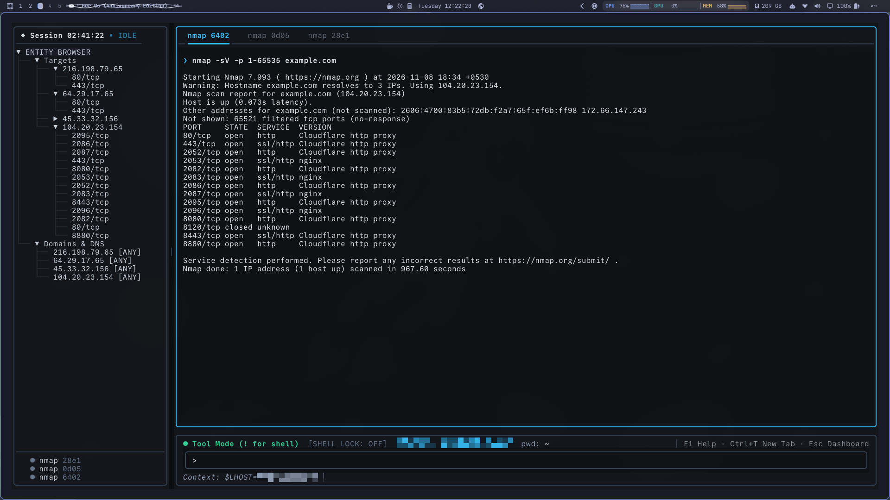
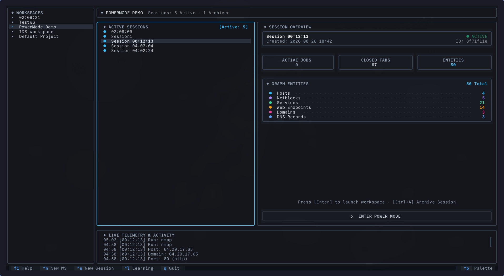
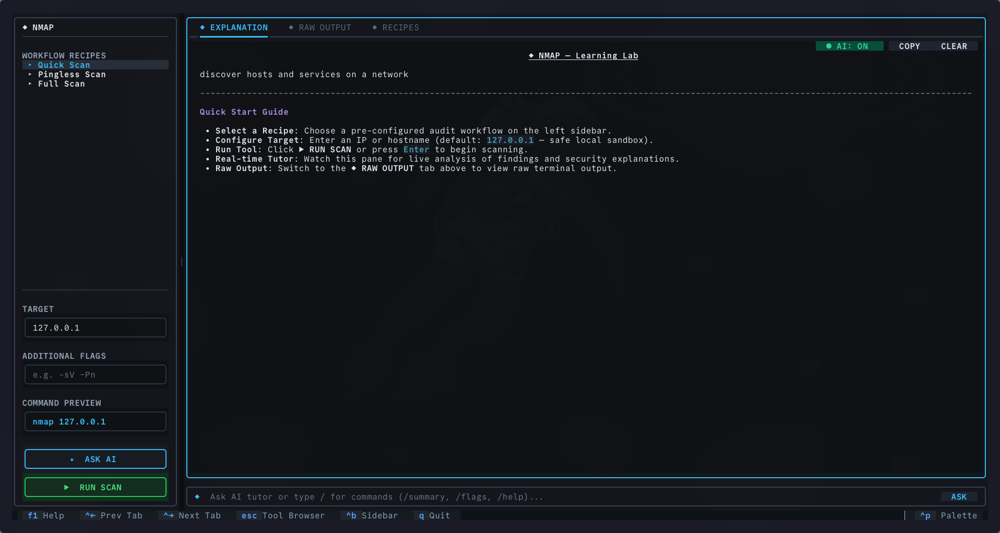
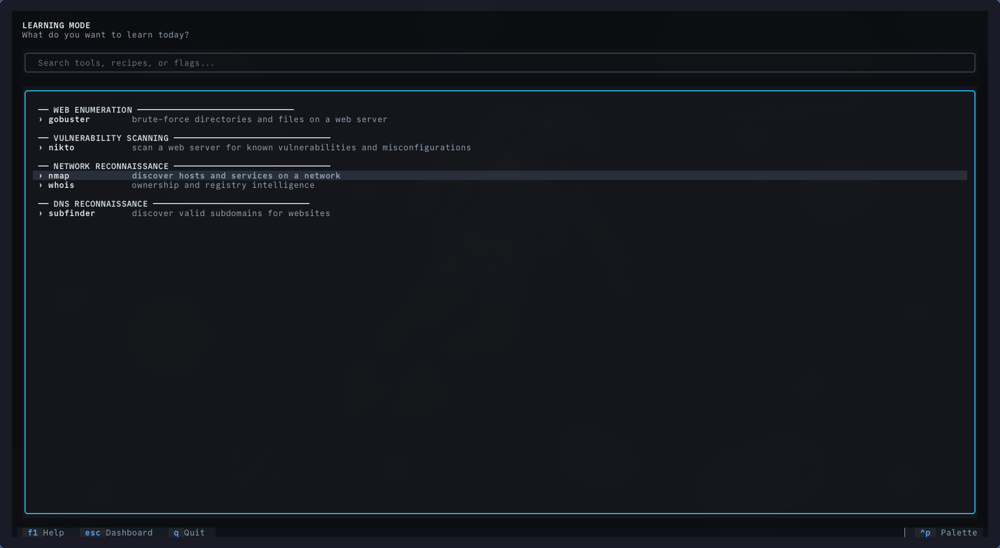
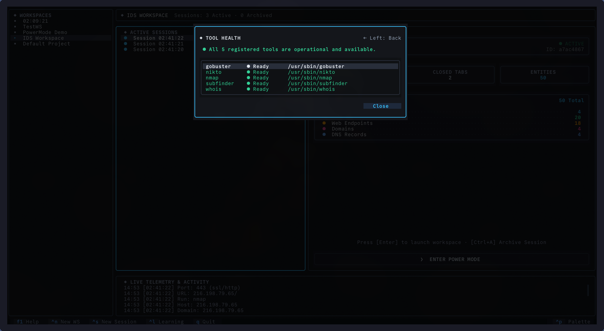
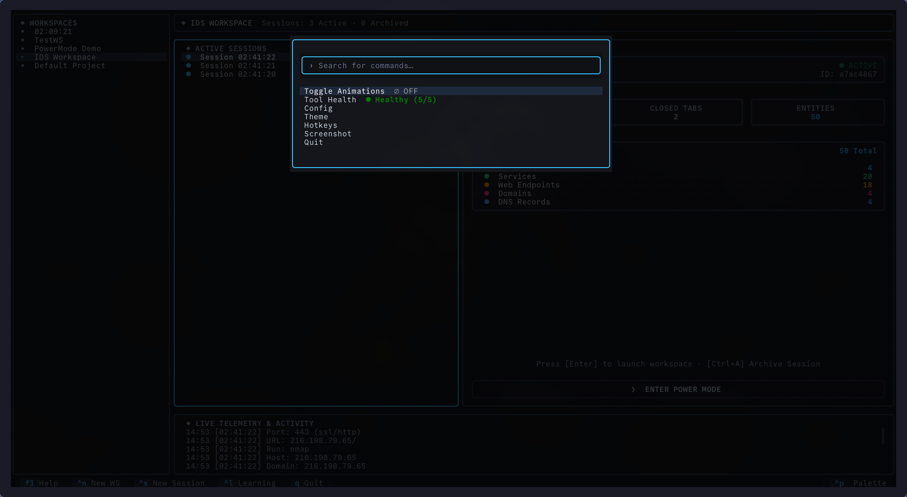

# CyGuide

[](https://github.com/h45sh/cyguide/actions/workflows/ci.yml)
[](https://github.com/h45sh/cyguide/actions/workflows/codeql.yml)
[](https://pypi.org/project/cyguide/)
[](https://pypi.org/project/cyguide/)
[](https://github.com/h45sh/cyguide/pkgs/container/cyguide)
[](https://h45sh.com/portfolio/cyguide/)
[](.github/SECURITY.md)
[](LICENSE)


**TUI-Based Guided Cybersecurity Learning and Terminal Tool Orchestration Platform.**

CyGuide transforms penetration testing and security learning from disorganized terminal tabs into an integrated, stateful terminal workstation. It orchestrates industry-standard security tools (`nmap`, `gobuster`, `nikto`, `whois`, `subfinder`), normalizes their outputs into a live entity graph, resolves contextual target variables dynamically, and provides real-time explanations through local (Ollama) or cloud AI models.

For an interactive overview and project showcase, visit the official webpage at [https://h45sh.com/portfolio/cyguide/](https://h45sh.com/portfolio/cyguide/).

<p align="center">
  <a href="assets/demo.mp4">
    
  </a>
  <br>
  <a href="assets/demo.mp4">🎬 <b>Watch the Full Terminal Workstation Video Walkthrough (assets/demo.mp4)</b></a>
</p>

---

## Why CyGuide?

* **No More Terminal Tab Chaos**: Run multiple reconnaissance tools concurrently with dedicated tabs, active job monitoring, and instant output review.
* **Stateful Entity Graph**: Discoveries (hosts, open ports, endpoints, DNS records, vulnerabilities) automatically link together in a deterministic graph using SHA-256 Primary Identity Keys (PIKs).
* **Universal Variable Injection**: Click any node in your target tree to bind variables (`$TARGET`, `$PORT`, `$SERVICE`) into subsequent commands without retyping IP addresses.
* **Offline-First AI Tutor**: Get immediate, structured breakdowns of scan results and security recommendations powered by local Ollama models or cloud APIs.
* **Portable Engagement Archives**: Export investigations into standalone `.db` archives and Markdown reports (`cyg export`). Instructors can import (`cyg import`) and replay a student's exact methodology step-by-step.

---

## Workstation Interface

CyGuide features two distinct terminal operational modes and an integrated diagnostic suite:

### 1. Power Mode (Multi-Tab Concurrent Workbench)
Run multiple asynchronous security tools concurrently, interact with live target graphs, and resolve `$TARGET`, `$PORT`, and `$SERVICE` variables on the fly:
<p align="center">
  
</p>

### 2. Dashboard Hub (Workspace & Session Management)
Organize complex penetration tests and CTFs into discrete workspaces and isolated sessions with full archive, rename, and export support (`Ctrl+N`, `Ctrl+S`):
<p align="center">
  
</p>

### 3. Guided Learning Mode & Interactive Tool Browser
Explore tool recipes, inspect command flags before execution, and receive AI-guided security breakdowns and hardening steps:
<p align="center">
  
</p>
<p align="center">
  
</p>

### 4. In-App Diagnostics & Unified Command Palette
Inspect security binary availability on `$PATH` in real time with `Ctrl+P` -> **Tool Health**, and configure AI providers, database paths, and custom plugins:
<p align="center">
  
</p>
<p align="center">
  
</p>

---

## Architecture Overview

CyGuide is built on a **Smart Adapter / Stupid Framework** model:

```text
┌────────────────────────────────────────────────────────────────────────┐
│                        Textual TUI Workstation                         │
│  [ Dashboard Hub ]   [ Guided Learning Mode ]   [ Power Mode Workbench]│
└───────────────────────────────────┬────────────────────────────────────┘
                                    │ Actions / Context
┌───────────────────────────────────▼────────────────────────────────────┐
│                       Deterministic Core Engine                        │
│  • ActionGateway (SSRF & Scope Policy)  • Subprocess Async Executor    │
│  • GraphStore (SQLite PIK Deduplication) • Reactive Recommendation Engine│
└───────────────────────────────────┬────────────────────────────────────┘
                                    │ Event Streaming
┌───────────────────────────────────▼────────────────────────────────────┐
│                         Security Tool Adapters                         │
│   nmap  •  gobuster  •  nikto  •  whois  •  subfinder  •  custom...    │
└────────────────────────────────────────────────────────────────────────┘
```

* **Core Engine (`cyguide/engine`)**: Asynchronous process executor, policy gateway, and SQLite graph store.
* **Unified Schemas (`cyguide/schemas`)**: 15 standard Pydantic models defining shared security entities.
* **Smart Adapters (`tools/`)**: Isolated plugins that construct commands and parse streaming output.
* **Textual TUI (`cyguide/ui`)**: Fast, keyboard-driven terminal interface with split panes and scratchpad.

---

## Installation & Getting Started

CyGuide can be run or installed through several methods depending on your workflow:

| Method | Best For | Security Tools | Setup Time |
| :--- | :--- | :--- | :--- |
| **Docker (GHCR)** | Quick trials, isolated testing, zero host pollution | Pre-bundled | < 30 seconds |
| **`pipx`** | Everyday CLI usage on Linux/macOS | Installed via script/OS | ~ 1 minute |
| **`pip` / PyPI** | Existing Python virtual environments | Installed via script/OS | ~ 1 minute |
| **Source (Git)** | Contributing, local tool plugin development | Installed via script/OS | ~ 2 minutes |

---

### Option 1: Instant Evaluation via Docker (Zero Setup)
Run CyGuide immediately with Python 3.11+ and all 5 security tools pre-installed inside an isolated container:

```bash
docker run -it --rm --net=host -v ~/.cyguide:/root/.cyguide ghcr.io/h45sh/cyguide
```
> [!NOTE]
> `--net=host` allows network scanners to probe target hosts seamlessly, and `-v ~/.cyguide:/root/.cyguide` ensures your session graphs, notes, and reports persist on your host machine.

---

### Option 2: Install via `pipx` (Recommended for Python CLI Users)
Install CyGuide into an isolated application environment:

```bash
pipx install cyguide
```
*(Ensure system security tools are installed via the Universal Installer or native package managers below).*

---

### Option 3: Install from PyPI or Source
If working inside a virtual environment or contributing to CyGuide:

```bash
# Install from PyPI
pip install cyguide

# OR clone and install editable for development
git clone https://github.com/h45sh/cyguide.git
cd cyguide
pip install -e .
```

---

### Installing Security Tools & Dependencies

CyGuide orchestrates standard CLI security tools. You can install them automatically using our universal installer, or manually with your package manager:

#### A. Automated Universal Installer (Recommended)
CyGuide includes an intelligent dependency installer that auto-detects your OS and package manager, installs dependencies, handles fallbacks (e.g. downloading official binaries if a tool isn't in your distro repos), and verifies the setup:

```bash
# Install system-wide (requires sudo)
./scripts/install_deps.sh

# Install standalone binaries into ~/.local/bin (no root/sudo needed)
./scripts/install_deps.sh --user

# Verify currently installed tools without making changes
./scripts/install_deps.sh --check
```

#### B. Native Package Manager Commands
If you prefer to install packages manually using your distribution's native package manager:

<details>
<summary><b>Debian / Ubuntu / Linux Mint / Pop!_OS</b></summary>

```bash
sudo apt update
sudo apt install -y nmap gobuster nikto whois libxml-writer-perl curl unzip

# Install subfinder (official ProjectDiscovery binary release)
curl -fsSL https://github.com/projectdiscovery/subfinder/releases/download/v2.6.6/subfinder_2.6.6_linux_amd64.zip -o /tmp/subfinder.zip
unzip -q /tmp/subfinder.zip -d /tmp && sudo mv /tmp/subfinder /usr/local/bin/ && rm /tmp/subfinder.zip
```
</details>

<details>
<summary><b>Kali Linux / Parrot OS</b></summary>

```bash
# All tools are natively available in official Kali & Parrot repositories
sudo apt update
sudo apt install -y nmap gobuster nikto whois subfinder libxml-writer-perl
```
</details>

<details>
<summary><b>Arch Linux / Manjaro / EndeavourOS / BlackArch</b></summary>

```bash
sudo pacman -Syu --needed nmap gobuster nikto whois subfinder perl-xml-writer
```
</details>

<details>
<summary><b>Fedora / RHEL / CentOS Stream / Rocky / AlmaLinux</b></summary>

```bash
sudo dnf install -y nmap whois perl-XML-Writer curl unzip
# Gobuster / Nikto / Subfinder (or run ./scripts/install_deps.sh for automated binaries)
sudo dnf install -y gobuster nikto 2>/dev/null || ./scripts/install_deps.sh
```
</details>

<details>
<summary><b>openSUSE (Tumbleweed / Leap)</b></summary>

```bash
sudo zypper install -y nmap whois perl-XML-Writer curl unzip
./scripts/install_deps.sh
```
</details>

<details>
<summary><b>Alpine Linux</b></summary>

```bash
sudo apk add nmap gobuster nikto whois perl-xml-writer curl unzip
./scripts/install_deps.sh
```
</details>

<details>
<summary><b>macOS (Homebrew)</b></summary>

```bash
brew install nmap gobuster nikto whois subfinder
```
</details>

---

## Launching CyGuide

```bash
# Launch with default centralized database (~/.cyguide/cyguide.db)
cyg

# Launch with a custom data directory
cyg --data-dir ~/.my_cyguide

# Launch with a custom SQLite database
cyg --db engagement.db
```

### AI Configuration (Ollama & Cloud)

CyGuide supports both local, privacy-preserving LLMs and cloud APIs:

#### Local LLM (Ollama)
Launch with the `--ollama` flag and specify an optional model (defaults to `gemma`):
```bash
cyg --ollama --ollama-model llama3
```

#### Cloud LLM Providers
Set your API key via environment variable or in the in-app settings dialog (`Ctrl+P` -> Configuration):
```bash
export CYGUIDE_API_KEY="your_api_key_here"

# Optional overrides (defaults to OpenAI / gpt-4o)
export CYGUIDE_API_TYPE="openai"       # Options: openai, anthropic
export CYGUIDE_API_BASE="https://api.openai.com/v1" # E.g., OpenRouter, Groq, DeepSeek
export CYGUIDE_API_MODEL="gpt-4o"
```

---

## Diagnostic Health Check

Verify your Python runtime, database write permissions, installed security tools, and AI backends:
```bash
cyg check
```
*(Use `cyg check --json` for scriptable JSON output in CI/CD pipelines).*

---

## Session Portability & Reporting

* **Export Session (`cyg export`)**: Creates a portable `.db` archive of findings, relationships, and raw commands:
  ```bash
  cyg export <session_id> exports/my_session.db
  ```
* **Generate Technical Report**: Produces a structured executive Markdown summary:
  ```bash
  cyg export <session_id> exports/my_session.db --report reports/investigation.md
  ```
* **Import Session (`cyg import`)**: Restores an archive into your local workspace:
  ```bash
  cyg import exports/my_session.db
  ```

---

## Documentation Hub

Our complete documentation is organized using the **[Diátaxis Framework](docs/README.md)**:

* **[Project Webpage](https://h45sh.com/portfolio/cyguide/)**: Interactive project overview, features, and showcase.
* **[Documentation Master Hub](docs/README.md)**: Central portal with role-based reading paths.
* **[User Manual](docs/user/USER_MANUAL.md)**: Navigation guide, hotkeys master table, and UI workflows.
* **[Architecture & Domain Context](docs/developer/ARCHITECTURE.md)**: Subsystem pipelines, ADRs, and facade contracts.
* **[Database Architecture & Specification](docs/developer/DATABASE.md)**: Relational schema, PIK hashing, and ER diagrams.
* **[Schema Registry](docs/developer/SCHEMA_REGISTRY.md)**: Standard 15-schema finding models and identity keys.
* **[Roadmap & Progress Tracker](docs/developer/ROADMAP.md)**: Project phases, active tasks, and historical milestones.
* **[Autonomous Agent Harness Vision](docs/developer/FUTURE_POWER_MODE.md)**: Architecture for autonomous ReAct loops and safety gates.
* **[Developer Performance Notes](docs/developer/DEVELOPER_NOTES.md)**: Real-time streaming, event loops, and lessons learned.
* **[Security Policy](.github/SECURITY.md)**: Vulnerability disclosure channels, response SLAs, and threat model scope.
* **[Contributing Guide](docs/user/CONTRIBUTING.md)**: Step-by-step guide for creating new tool plugins, code standards, and PR templates.


---

## Contributing

Contributions are warmly welcomed! Please read our **[Contributing Guide](docs/user/CONTRIBUTING.md)** to learn how to create new tool plugins, configure pre-commit hooks, and run the verification pipeline:

```bash
./scripts/verify.sh
```

---

## License

This project is licensed under the MIT License - see the [LICENSE](LICENSE) file for details.

