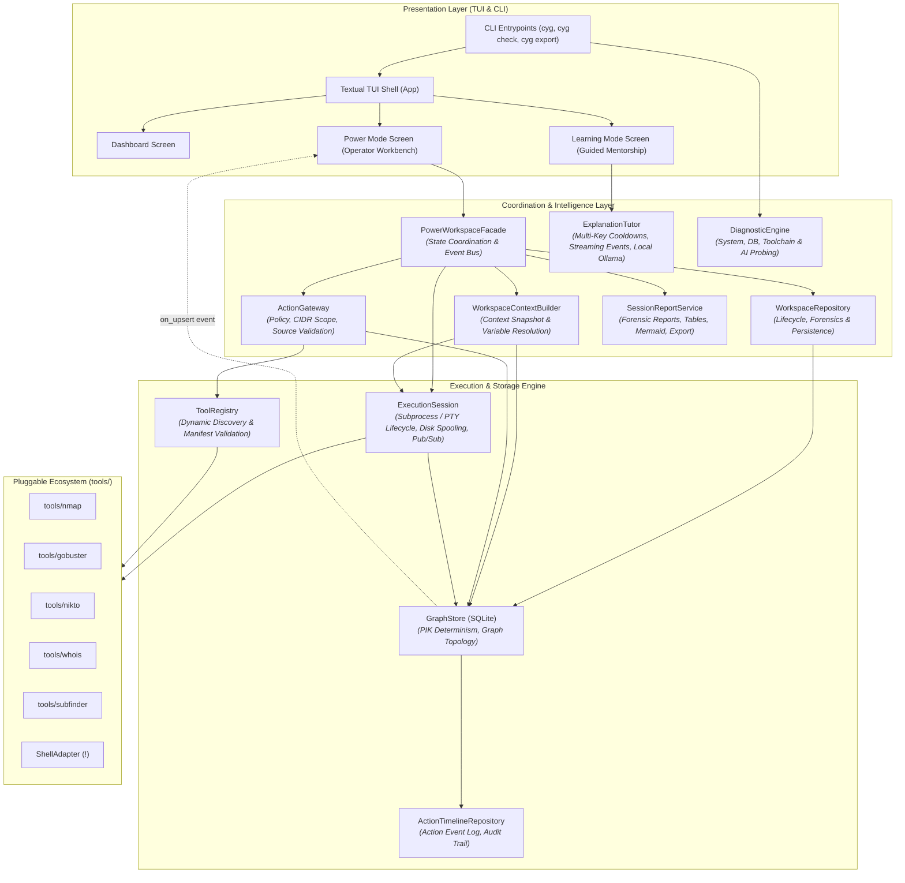
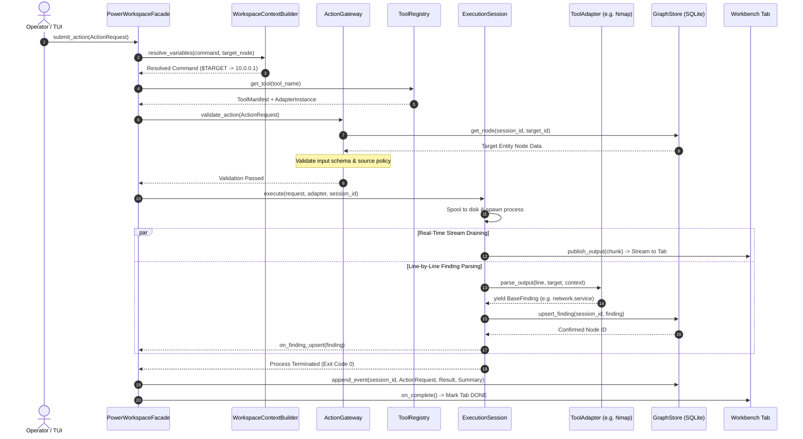
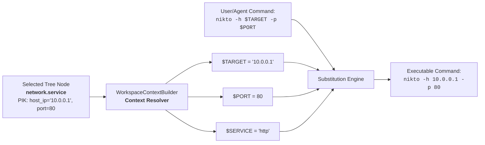

# CyGuide System Architecture & Engineering Blueprint

Welcome to the authoritative system architecture specification for CyGuide. This document details the engineering design, modular subsystems, execution pipelines, variable substitution mechanics, plugin discovery lifecycle, architectural decision records (ADRs), and governance rules that define the platform.

---

## 1. Core Philosophy: The Smart-Adapter Platform

CyGuide is a modular cybersecurity investigation and learning platform built for the terminal. It is engineered to solve a pervasive industry problem: **tool fragmentation and cognitive overload**. In traditional workflows, security practitioners run disparate CLI tools (`nmap`, `gobuster`, `nikto`, `whois`, `subfinder`) that emit incompatible text, XML, and JSON outputs, requiring tedious manual correlation.

CyGuide solves this through a **"Smart Adapter / Stupid Framework"** architecture:

```text
┌────────────────────────────────────────────────────────────────────────────────────────┐
│                                 THE "STUPID" FRAMEWORK                                 │
│                                                                                        │
│   • Agnostic to specific security tools                                                │
│   • Understands only standardized findings (BaseFinding schemas)                       │
│   • Manages asynchronous execution, process lifecycle, and TUI rendering               │
│   • Builds and queries stateful entity graphs via GraphStore                           │
└───────────────────────────────────────────▲────────────────────────────────────────────┘
                                            │ Standardized BaseFinding streams
┌───────────────────────────────────────────┴────────────────────────────────────────────┐
│                                 THE "SMART" ADAPTERS                                   │
│                                                                                        │
│   • tools/nmap       -> Encapsulates nmap flags, stdout parsing, and host/service models│
│   • tools/gobuster   -> Encapsulates directory fuzzing and endpoint generation         │
│   • tools/nikto      -> Encapsulates web vulnerability discovery and CVE linking        │
│   • tools/whois      -> Encapsulates domain and netblock extraction                     │
│   • tools/subfinder  -> Encapsulates passive subdomain discovery                        │
└────────────────────────────────────────────────────────────────────────────────────────┘
```

### Key Architectural Invariants:
1. **Additive Extensibility**: Adding support for a new security tool never requires modifying core engine, database, or UI code. A developer simply adds a standalone directory under `tools/` containing a `manifest.toml` and `adapter.py`.
2. **Deterministic Canonicalization**: Raw tool outputs are sanitized syntactically before ingestion, ensuring uniform IP addresses, lowercased domains, and normalized URL endpoints.
3. **Strict Separation of Concerns**: The user interface (Textual TUI) is completely decoupled from process execution, policy validation, and storage logic.

---

## 2. High-Level System Component Topology

The system is organized into modular layers with explicit unidirectional dependencies:



---

## 3. Domain Model & Core Terminology

* **Finding (`BaseFinding`)**: The atomic unit of intelligence in CyGuide. Inherits from Pydantic `BaseModel` and encapsulates schema classification, Primary Identity Keys, payload data, parent links, and associations.
* **Schema**: A formal Pydantic contract in `cyguide/schemas/` defining the data fields and identity rules for an entity type (e.g., `network.host`, `network.service`, `web.endpoint`).
* **Primary Identity Key (PIK)**: The deterministic set of identifying fields for a schema (e.g., `{"ip": "192.168.1.1"}` for `network.host`). Used to generate deterministic SHA-256 Node IDs for deduplication and upserts.
* **Workspace**: The root container for a project or engagement (e.g., "Internal Audit 2026"). Contains multiple sessions and global graph rollups.
* **Session**: A specific thread of investigation within a workspace:
  * **Power Session**: Persistent SQLite-backed investigation featuring interactive entity trees, parallel workbench tabs, command palettes, and action histories.
  * **Learning Session**: Ephemeral guided exploration sandbox backed by an AI Explainer (`ExplanationTutor` with local Ollama or cloud LLM fallbacks).
* **Entity Graph**: A directed graph representing the current target state for a session. Built using parent-child edges and semantic association links.
* **Event Log**: An append-only, immutable audit trail of every executed tool action, raw shell command, and generated finding. Ensures full investigation reproducibility and workbench tab restoration.
* **Entity Alias**: A finding (`entity.alias`) mapping two semantically identical but syntactically distinct identifiers (e.g., resolving a hostname to an IP address).

---

## 4. The Layered Execution Pipeline (Power Mode)

To enable future autonomous AI agents without compromising safety, Power Mode implements a strict 5-stage layered execution pipeline. This cleanly isolates user intent from process management:

```text
[ 1. User Interface / Agent Layer ]
       │ Submits ActionRequest(tool="nmap", params={"raw_flags": "-sV $TARGET"}, target="node_123")
       ▼
[ 2. PowerWorkspaceFacade & ContextBuilder ] ─── Resolves $TARGET to "192.168.1.10", validates scope
       │ Passes resolved ActionRequest
       ▼
[ 3. ActionGateway ] ────────── Validates tool registration, target compatibility, USER vs AGENT policy
       │ Passes validated ActionRequest & Adapter
       ▼
[ 4. ExecutionSession ] ─────── Manages subprocess / PTY lifecycle, disk spooling, and pub/sub streaming
       │ Dispatches process execution via Async Executor
       ▼
[ 5. Tool Adapter & Shell ] ─── Parses stdout lines, emits structured findings to GraphStore
```

### 4.1. Stage-by-Stage Component Responsibilities

#### 1. Presentation Layer (Textual TUI)
* Captures user input from the Command Palette (`[tool]` or `[shell]` mode).
* Maintains active node selections in the Entity Tree.
* Renders parallel terminal tabs with rolling output buffers and syntax highlighting.
* Completely decoupled from process spawning or direct database mutations.

#### 2. `PowerWorkspaceFacade` ([`cyguide/engine/power_facade.py`](../../cyguide/engine/power_facade.py))
* Serves as the **single programmatic API** for both the Textual TUI and future AI agents.
* Coordinates specialized deep modules:
  * **Context Resolution**: Delegates `$TARGET`, `$PORT`, `$SERVICE` variable resolution and snapshot generation to [`WorkspaceContextBuilder`](../../cyguide/engine/context_builder.py).
  * **Workspace Lifecycle**: Delegates engagement creation, renaming, and forensic closing to [`WorkspaceRepository`](../../cyguide/engine/workspace_repository.py).
  * **Job Management**: Delegates subprocess execution and output distribution to [`ExecutionSession`](../../cyguide/engine/execution_session.py).
  * **Session Reporting**: Delegates forensic investigation exports and Markdown summaries to [`SessionReportService`](../../cyguide/engine/reporter.py).

#### 3. `ActionGateway` ([`cyguide/engine/gateway.py`](../../cyguide/engine/gateway.py))
* Evaluates action requests against security and structural policies before any process is spawned.
* **Policy Enforcement**:
  * **Tool Registration**: Validates that the requested tool exists in the `ToolRegistry`.
  * **Source Gating**: Restricts arbitrary shell execution (`is_explicit_shell=True`) strictly to `ActionSource.USER`, preventing autonomous AI agents from escaping into unsanctioned shell commands.
  * **Input Compatibility**: Verifies that the selected target finding matches the input types accepted in the tool's `manifest.toml` (e.g., preventing `gobuster` from targeting a raw `network.netblock`).

#### 4. `ExecutionSession` ([`cyguide/engine/execution_session.py`](../../cyguide/engine/execution_session.py)) & `Executor` ([`cyguide/engine/executor.py`](../../cyguide/engine/executor.py))
* **`ExecutionSession`**: Deep module encapsulating the complete runtime lifecycle of active tool tasks and shell commands. Coordinates process spawning, temporary disk spooling, output streaming pub/sub to UI tabs, and atomic result status updates.
* **`Executor`**: Asynchronously executes binaries via `asyncio.create_subprocess_exec` (with environment sanitization and API key scrubbing). Concurrently drains stdout/stderr, feeds lines to the tool adapter's parser, and persists findings to `GraphStore`.
* Handles process termination (`stop_task`) and cleanup during job cancellation (`ctrl+k`).

#### 5. `ToolAdapter` ([`cyguide/engine/adapter.py`](../../cyguide/engine/adapter.py))
* The plugin implementation that defines CLI arguments (`build_command`) and parses line-by-line tool output (`parse_output`) into strongly-typed `BaseFinding` schemas.

---

### 4.2. End-to-End Execution Sequence Diagram



---

## 5. Universal Variable Substitution Engine

To enable an identical command interface for human operators and automated agents, variable substitution is handled centrally in [`WorkspaceContextBuilder`](../../cyguide/engine/context_builder.py) and exposed through `PowerWorkspaceFacade.get_context()`.



### Context Resolution Rules:
* `$TARGET`: Resolved hierarchically from `ip`, `domain`, or `host_ip` in the selected finding's PIK.
* `$PORT`: Resolved from `port` in `network.service` or `web.endpoint`.
* `$SERVICE`: Resolved from `service` or `service_name` metadata.
* `$PROTOCOL`: Resolved from `protocol` (`tcp`/`udp`).

---

## 6. Dynamic Plugin Discovery & Adapter Architecture

The plugin ecosystem allows adding tools dynamically without compiling or modifying the core platform.

```
tools/
├── nmap/
│   ├── manifest.toml        # Declarative metadata, accepted inputs, and documentation
│   └── adapter.py           # Subclass of ToolAdapter implementing CLI build & stdout parsing
├── gobuster/
│   ├── manifest.toml
│   └── adapter.py
└── ...
```

### 6.1. Manifest Schema (`manifest.toml`)
```toml
[meta]
name = "nmap"
version = "7.94"
description = "Network exploration tool and security / port scanner"
author = "CyGuide Core Team"

[input]
accepts = ["network.host", "network.netblock"]

[output]
produces = ["network.host", "network.service"]

[ui]
category = "Discovery"
default_command = "nmap -sV $TARGET"
```

### 6.2. `ToolAdapter` Abstract Contract
Every tool adapter inherits from `ToolAdapter` in [`cyguide/engine/adapter.py`](../../cyguide/engine/adapter.py):

```python
class ToolAdapter(ABC):
    @abstractmethod
    def validate_install(self) -> bool:
        """Verify that the required binary exists in system PATH."""
        pass

    @abstractmethod
    def build_command(self, target: BaseFinding, params: Dict[str, Any]) -> List[str]:
        """Construct the CLI arguments list."""
        pass

    @abstractmethod
    async def parse_output(
        self,
        raw_stdout: str,
        target: BaseFinding,
        context: Dict[str, Any] = None
    ) -> AsyncIterator[BaseFinding]:
        """Parse raw stdout and yield standardized BaseFinding objects."""
        pass
```

### 6.3. Dynamic Loader Pipeline in `ToolRegistry`
1. Scans `tools/` at application startup.
2. Reads and parses `manifest.toml` using `tomllib`.
3. Dynamically loads `adapter.py` via `importlib.util.spec_from_file_location()`.
4. Instantiates the `ToolAdapter` subclass and registers it in the active tool catalog.
5. Surfaces missing binary warnings in `cyg check` diagnostics without crashing the application.

---

## 7. Target Intelligence Architecture (Planned `TargetAdvisor`)

The legacy heuristic 4-rule recommendation engine was decommissioned to eliminate noisy background SQLite writes during high-volume tool execution. In Phase 4 (Track 4 of the project roadmap), target suggestions are superseded by the **On-Demand Neuro-Symbolic Target Advisor (`TargetAdvisor`)**:

* **Operator-Triggered (Not Background)**: Triggered explicitly on a selected entity in the Entity Tree (via Command Palette or hotkey) or by an autonomous agent during its ReAct decision loop, rather than silently firing on every background node upsert.
* **Context-Aware Reasoning**: Assembles structured entity briefs (open ports, banners, OS, existing findings) through `WorkspaceContextBuilder` and passes them to `ExplanationTutor` for contextual next-step recommendations.
* **Policy-Gated**: All suggested actions pass through `ActionGateway` for deterministic CIDR boundary enforcement, SSRF prevention, and parameter validation before operator authorization.

---

## 8. AI Explainer Architecture (Learning Mode)

Learning Mode provides real-time, context-aware cybersecurity mentorship powered by local or cloud Large Language Models via [`ExplanationTutor`](../../cyguide/engine/explainer.py).

```text
┌──────────────────────────────────────────────────────────────────────────┐
│                         ExplanationTutor (Deep Module)                   │
├─────────────────────────────────────┬────────────────────────────────────┤
│ Local Ollama Backend                │ Multi-Key Cloud Backend            │
│ • Local inference (zero API keys)   │ • OpenAI (gpt-4o, etc.)            │
│ • Endpoints: http://localhost:11434 │ • Anthropic (Claude 3.5 Sonnet)    │
│ • Default model: gemma / llama3     │ • OpenRouter, Groq, DeepSeek       │
│ • Streaming HTTP chunk consumer     │ • Streaming SSE & Token Pipeline   │
└─────────────────────────────────────┴────────────────────────────────────┘
```

* **Encapsulated Resilience**: `ExplanationTutor` manages the complete intelligence lifecycle: multi-provider key selection, rate-limit cooldown tracking, prompt boundary sanitization, streaming event pub/sub, and automatic fallback to local Ollama.
* **Non-Blocking Streaming**: Explanations stream token-by-token directly into the Learning Mode Markdown reader using `httpx.AsyncClient`.
* **Zero UI Hanging**: If an LLM provider is unavailable or times out, CyGuide fails gracefully with clear diagnostic guidance rather than hanging the interface.

---

## 9. Diagnostic & Health Engine (`cyg check`)

CyGuide features a dedicated environment diagnostic suite in [`cyguide/engine/diagnostics.py`](../../cyguide/engine/diagnostics.py) powered by `DiagnosticEngine`.

### Deep Probe Architecture:
`DiagnosticEngine` exposes a simple high-leverage interface (`run_all()`, `run_probe()`, `probe_system()`, `probe_storage()`, `probe_tools()`, `probe_ai()`) that returns structured, strongly-typed `DiagnosticReport` and `ProbeResult` models.

1. **System Environment**: Python version ($\ge 3.11$), operating system, Textual TUI framework availability.
2. **Storage Integrity**: Writable `data/` directory, SQLite table existence, database `PRAGMA integrity_check`.
3. **Security Tool Discovery**: Validates presence of `nmap`, `gobuster`, `nikto`, `subfinder`, and `whois` in `$PATH`.
4. **AI Explainer Connectivity**: Verifies local Ollama HTTP status and inspects cloud API key configurations (`CYGUIDE_API_KEY`, `OPENAI_API_KEY`, `ANTHROPIC_API_KEY`).

In addition to the CLI command (`cyg check`), the active TUI surfaces a live interactive `ToolHealthModal` via the Command Palette (`Ctrl+P`), giving operators real-time discovery badges, exact binary paths, and copyable installation hints without leaving the workbench.

---

## 10. Architectural Decision Records (ADRs)

### ADR-01: Smart-Adapter Plugin Model vs. Monolithic Parsing
* **Context**: Parsing logic for dozens of security tools could either be embedded in the core engine or split into plugins.
* **Decision**: Adopt the "Smart Adapter / Stupid Framework" pattern.
* **Consequences**: Adding new tools requires zero edits to the core engine, UI, or database models. Isolation prevents bugs in a single parser from destabilizing the entire platform.

### ADR-02: Programmatic `PowerWorkspaceFacade` as the Single API Boundary
* **Context**: UI widgets could directly call the database and executor, or communicate through a unified facade.
* **Decision**: Enforce all mutations, queries, and execution requests through `PowerWorkspaceFacade`.
* **Consequences**: Enables seamless transition to future autonomous AI agent drivers without rewriting UI or execution logic.

### ADR-03: Engine-Level Universal Variable Resolution
* **Context**: Variable placeholders (`$TARGET`, `$PORT`) could be resolved either in the Textual TUI Command Palette or inside the engine.
* **Decision**: Implement variable substitution in `PowerWorkspaceFacade.get_context()`.
* **Consequences**: Guarantees identical execution semantics whether a command is triggered by human keystrokes in the TUI, via automated batch scripts, or by an AI agent.

### ADR-04: Dual Graph/Event-Log Persistence Model
* **Context**: We needed both rapid graph queries for UI trees and historical auditability for lab grading.
* **Decision**: Implement both `nodes`/`edges` (stateful current truth) and `event_log` (immutable append-only history).
* **Consequences**: Provides sub-millisecond tree rendering while preserving complete replayability and tab state restoration across sessions.

### ADR-05: Source-Gated Action Policy (`USER` vs. `AGENT`)
* **Context**: Arbitrary shell commands (`!rm -rf /`) present safety hazards for autonomous systems.
* **Decision**: In `ActionGateway`, restrict explicit shell commands (`!`) strictly to `ActionSource.USER`. Autonomous agents are restricted to registered tools conforming to validated schemas.
* **Consequences**: Guarantees safety during automated AI investigations without limiting operator freedom.

### ADR-06: Async Terminal TUI (Textual) over Web/Electron Stacks
* **Context**: The user interface could be implemented as a web app, Electron GUI, or terminal TUI.
* **Decision**: Build on [Textual](https://textual.textualize.io/) (async Python TUI).
* **Consequences**: Zero desktop browser overhead, native SSH execution on remote headless audit targets, and instant keyboard-driven operator ergonomics.

### ADR-07: Zero-Overhead SQLite ATTACH/DETACH for Session Portability
* **Context**: Exporting sessions could involve serializing to massive JSON dumps or using native database engines.
* **Decision**: Use SQLite native `ATTACH DATABASE` and `INSERT INTO dest.* SELECT ... FROM src.*`.
* **Consequences**: Transactional, atomic, zero-memory exports producing standalone `.db` files that can be shared, graded, and inspected using standard SQLite tools.

### ADR-08: Deep Modules & High-Leverage Architectural Seams
* **Context**: As CyGuide grew, cross-cutting concerns (workspace lifecycle, report generation, context variable resolution, timeline logging, execution streaming, diagnostic probing) were intermingled inside UI layers and large procedural methods.
* **Decision**: Refactor the codebase around 8 "Deep Modules" (John Ousterhout principle: small, simple interfaces hiding substantial internal complexity):
  1. `ExecutionSession` ([`cyguide/engine/execution_session.py`](../../cyguide/engine/execution_session.py)): Subprocess lifecycle, PTY execution, disk spooling, and pub/sub output streaming.
  2. `ExplanationTutor` ([`cyguide/engine/explainer.py`](../../cyguide/engine/explainer.py)): Multi-key cloud fallbacks, cooldown tracking, prompt boundary sanitization, and local Ollama failover.
  3. `WorkspaceRepository` ([`cyguide/engine/workspace_repository.py`](../../cyguide/engine/workspace_repository.py)): Workspace and session CRUD, forensic read-only locking, and persistence.
  4. Declarative `BaseFinding` Canonicalization ([`cyguide/schemas/base.py`](../../cyguide/schemas/base.py)): Automatic whitespace trimming, lowercase normalizations, and IPv6 expansion via Pydantic model configuration.
  5. `SessionReportService` ([`cyguide/engine/reporter.py`](../../cyguide/engine/reporter.py)): Multi-format forensic reporting, Markdown tables, Mermaid attack flow graphs, and stat summaries.
  6. `ActionTimelineRepository` ([`cyguide/engine/timeline.py`](../../cyguide/engine/timeline.py)): Append-only action event logs, tab state restoration, and timeline replay queries.
  7. `WorkspaceContextBuilder` ([`cyguide/engine/context_builder.py`](../../cyguide/engine/context_builder.py)): Hierarchical entity context extraction and `$TARGET` / `$PORT` / `$SERVICE` variable substitution.
  8. `DiagnosticEngine` ([`cyguide/engine/diagnostics.py`](../../cyguide/engine/diagnostics.py)): Pluggable probe registry for system, database, security toolchain, and AI connectivity.
* **Consequences**: Drastic reduction in cognitive load and high locality of change. Adding new features, security tools, or AI models requires zero modifications to core orchestration pipelines.

---

## 11. Codebase Governance & Tiered Protection

To maintain codebase stability for university evaluation and production deployment, CyGuide enforces a strict tiered file protection policy:

```text
┌────────────────────────────────────────────────────────────────────────┐
│                        TIER 1: FROZEN CORE                             │
│   • cyguide/schemas/base.py       • cyguide/engine/store.py            │
│   • cyguide/common/canonicalize.py • cyguide/engine/registry.py       │
│   • cyguide/paths.py                                                   │
│   Governance: Core infrastructure. Changes require deep review and      │
│   team agreement.                                                      │
├────────────────────────────────────────────────────────────────────────┤
│                        TIER 2: REVIEW REQUIRED                         │
│   • tools/*/adapter.py            • cyguide/engine/executor.py         │
│   • cyguide/schemas/*.py          • cyguide/engine/power_facade.py     │
│   • cyguide/engine/explainer.py   • cyguide/engine/gateway.py          │
│   Governance: Architectural components. Changes require unit tests.    │
├────────────────────────────────────────────────────────────────────────┤
│                        TIER 3: FREE TO CHANGE                          │
│   • cyguide/ui/ (Screens/Widgets) • cyguide/schemas/                   │
│   • docs/ and scripts/            • tests/                             │
│   Governance: Layouts, styles, utility helpers, and documentation.     │

└────────────────────────────────────────────────────────────────────────┘
```

---

## 12. Centralized Application Paths & Storage Isolation

To prevent directory pollution and support multi-user and multi-tenant environments, CyGuide centralizes path resolution in [`cyguide/paths.py`](../../cyguide/paths.py).

### Path Hierarchy & Resolution Rules:
* **Root Unified Directory**: Resolves by priority:
  1. `CYGUIDE_DATA_DIR` environment variable (if specified).
  2. `~/.cyguide` in the operator's home directory.
* **Database File**: `get_default_db_path()` defaults to `<data_dir>/cyguide.db` unless overridden by `--db <path>`.
* **User Settings**: `<data_dir>/settings.json` stores persistent TUI preferences (animations, sidebar state, active AI key, fallback configs).
* **Scratchpad Markdown**: `<data_dir>/scratchpad.md` stores quick operator notes across sessions with restrictive filesystem permissions (`0o600`).
* **Session Exports & Reports**: Subdirectories `<data_dir>/exports` and `<data_dir>/reports` isolate atomic SQLite export archives and generated markdown findings.

---

## 13. Resilient Multi-Provider AI Fallback Engine

Learning Mode and AI explainers feature a multi-tiered fallback architecture managed by `ExplanationTutor` in [`cyguide/engine/explainer.py`](../../cyguide/engine/explainer.py):

```text
┌──────────────────────────────────────────────────────────────────────────┐
│                             ExplanationTutor                             │
├──────────────────────────────────────────────────────────────────────────┤
│ 1. Active Primary Key Profile (OpenAI / Claude / Groq / OpenRouter)       │
│    │ Failed (429 Rate Limited, 503 Outage, or Network Timeout)           │
│    ▼                                                                     │
│ 2. Automatic Cooldown & Failover to Enabled Fallback Profiles             │
│    │ All Cloud Keys Exhausted or Offline                                 │
│    ▼                                                                     │
│ 3. Automatic Graceful Fallback to Local Ollama (if configured)           │
│    │ Ollama Unavailable                                                  │
│    ▼                                                                     │
│ 4. Clear Diagnostic Guidance & Zero UI Hanging                           │
└──────────────────────────────────────────────────────────────────────────┘
```

* **`CloudKeyProfile`**: Tracks individual key configurations, active/standby states, rate-limit cooldown timers (`cooldown_until`), and health indicators.
* **Automatic Placeholder Rejection**: `is_placeholder_key()` filters out default documentation tokens (`your_api_key_here`, `sk-...`, `changeme`) without sending bogus network requests.

---

## 14. Interactive Configuration & UI Subsystem

CyGuide integrates interactive modal screens and reusable widgets that adhere to strict layer separation:

* **`ConfigModal` ([`cyguide/ui/screens/config_modal.py`](../../cyguide/ui/screens/config_modal.py))**:
  - Live configuration editor with dedicated tab panes for **Local LLM (Ollama)**, **Cloud AI (Key Profiles & Fallback)**, **Database Paths**, and **Custom Tools**.
  - Integrated with the Textual Command Palette (`Ctrl+P`) via specialized sub-palette providers (`ConfigProvider`, `OllamaConfigProvider`, `CloudAPIConfigProvider`, `DatabaseConfigProvider`, `ToolsConfigProvider`).
* **`ResizeHandle` ([`cyguide/ui/widgets/resizer.py`](../../cyguide/ui/widgets/resizer.py))**:
  - Decoupled, draggable pane splitter allowing operators to resize the Entity Browser, Workbench Terminals, and AI Suggestions sidebar interactively.
  - Automatically persists customized pane widths into `settings.json`.

---

## 15. Forensic Session Lifecycle & Archiving

In addition to standard active investigations, CyGuide implements forensic session archiving to preserve chain-of-custody without data loss:

* **Session States**: Sessions transition between `'ACTIVE'` and `'CLOSED'`.
* **Forensic Protection**: When closed, `PowerWorkspaceFacade` enforces read-only guards (`PermissionError`) preventing accidental execution of new scans or modification of historical findings.
* **Audit Trail**: State transitions trigger automated append-only `event_log` entries (`session_closed`, `session_reopened`).
* **Reversibility**: Archived sessions can be inspected historically or reopened to `'ACTIVE'` status at any time.

---

## 16. Defense-in-Depth Security Architecture

CyGuide implements strict defense-in-depth controls across process execution, network gating, credential storage, database persistence, and AI prompt interfaces:

### 16.1. Subprocess Isolation & Secret Scrubbing
* **Non-Shell Execution**: All security tools are spawned directly via `asyncio.create_subprocess_exec` argument vectors rather than shell string interpolation (`shell=True`), preventing arbitrary command injection.
* **Environment Sanitization**: [`sanitize_subprocess_env()`](../../cyguide/engine/executor.py) scrubs all sensitive API keys (`CYGUIDE_*`, `OPENAI_*`, `ANTHROPIC_*`, `GROQ_*`, `DEEPSEEK_*`, `PERPLEXITY_*`, `HUGGINGFACE_*`, etc.) and system credentials (`AWS_*`, `GITHUB_*`, `VAULT_TOKEN`, `SSH_PRIVATE_KEY`) so child processes never inherit operator secrets.

### 16.2. Link-Local & Cloud Metadata SSRF Gating
* **Destination Policy**: [`ActionGateway`](../../cyguide/engine/gateway.py) validates all target entities and raw CLI flags against `BLOCKED_TARGETS`.
* **Covered Metadata Endpoints**: Enforces comprehensive blocking across:
  - IPv4 Link-Local subnet (`169.254.0.0/16`) covering AWS, Azure (`169.254.169.250`), GCP, DigitalOcean, and Oracle Cloud metadata.
  - AWS IMDSv2 IPv6 Link-Local (`fd00:ec2::254`).
  - Alibaba Cloud metadata (`100.100.100.200`).
  - Alternate numeric encodings (decimal `2852039166`, hex `0xa9fea9fe`).
  - Cloud DNS hostnames (`metadata.google.internal`, `metadata.internal`, `instance-data`).

### 16.3. Atomic Private File Permissions
* **Credentials & Settings**: Persistent configurations (`settings.json`) containing API keys and operator notes (`scratchpad.md`) are created atomically with mode `0o600` (`-rw-------`, user read/write only) via `os.open(..., os.O_CREAT | os.O_WRONLY | os.O_TRUNC, 0o600)`.
* **Zero Race Conditions**: Eliminates Time-of-Check to Time-of-Use (TOCTOU) permission windows where world-readable files could momentarily be exposed under default system umasks.

### 16.4. AI Prompt Injection & Boundary Delimiters
* **Structured Tag Isolation**: Raw target scanner outputs fed to the AI Explainer are encapsulated inside `<untrusted_scan_output>` blocks with explicit system directives.
* **Tag Breakout Neutralization**: Closing XML tags (`</untrusted_scan_output>`) within untrusted scanner logs are sanitized to `<\\/untrusted_scan_output>`, preventing adversarial network banners or HTTP payloads from prematurely terminating the data block to inject instructions.

### 16.5. SQLite Database Hardening
* **Injection-Proof Queries**: 100% of SQL statements utilize parameterized queries (e.g. `ATTACH DATABASE ? AS src`).
* **Trigger & Schema Protection**: Every connection executes `PRAGMA trusted_schema = OFF` to prevent malicious triggers or virtual tables in imported databases, and `PRAGMA foreign_keys = ON` for cascade integrity.

---

## 17. Related Technical Documentation

* **[Database Architecture & Storage Specification (`docs/developer/DATABASE.md`)](DATABASE.md)**: Full DDL schemas, ER diagrams, PIK formulas, auto-wiring mechanics, and query recipes.
* **[Schema Registry (`docs/developer/SCHEMA_REGISTRY.md`)](SCHEMA_REGISTRY.md)**: The standard 15-schema finding vocabulary and PIK declarations.
* **[Project Roadmap & Progress Tracker (`docs/developer/ROADMAP.md`)](ROADMAP.md)**: Feature checklist, implementation phases, and development history.
* **[User Manual (`docs/user/USER_MANUAL.md`)](../user/USER_MANUAL.md)**: Operating instructions, hotkeys, and CLI reference.
* **[Contributing Guide (`docs/user/CONTRIBUTING.md`)](../user/CONTRIBUTING.md)**: Plugin contract, implementation patterns, tiered protection rules, and test verification.
