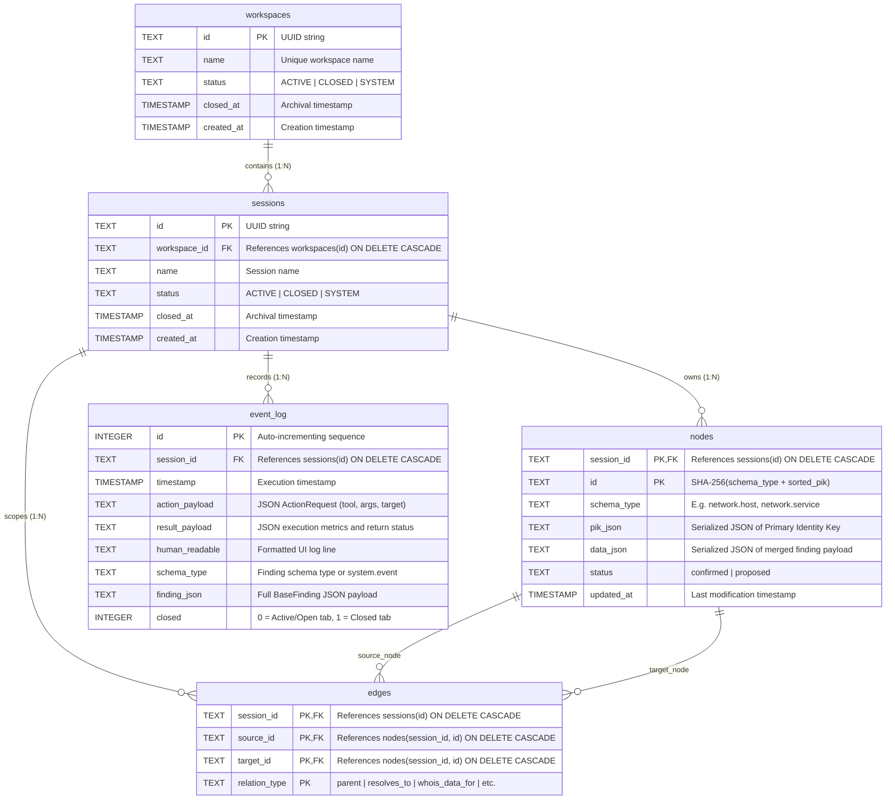
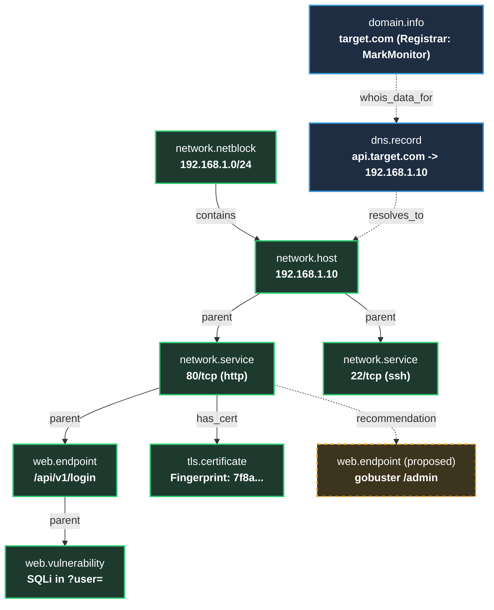

# CyGuide Database Architecture & Storage Specification

Welcome to the internal developer database specification for CyGuide. This document provides an exhaustive, authoritative guide to CyGuide's storage engine, relational schema, deterministic entity graph, Primary Identity Key (PIK) system, lifecycle workflows, and cross-database portability mechanics.

---

## 1. Architectural Overview & Design Philosophies

CyGuide’s storage architecture is engineered to solve a core challenge in cybersecurity operations and education: **tool fragmentation, stateful correlation, and investigation reproducibility**.

```text
┌──────────────────────────────────────────────────────────────────────────┐
│                             CyGuide Runtime                              │
├───────────────────────┬──────────────────────────────────────────────────┤
│ Tool Adapters         │ Yield standardized BaseFinding objects           │
│ Repository Layer      │ WorkspaceRepository & ActionTimelineRepository   │
│ GraphStore Engine     │ Enforces PIKs, hashes IDs, auto-wires relations  │
│ SQLite Storage Layer  │ Stores relational entities, graphs & event logs  │
│ Portability Subsystem │ ATTACH/DETACH zero-copy session export/import    │
└───────────────────────┴──────────────────────────────────────────────────┘
```

### Core Design Tenets:

1. **Embedded & Zero-Configuration**: Powered by **SQLite 3** via asynchronous [`aiosqlite`](https://aiosqlite.omnilib.dev/). No external database servers, connection strings, or background daemons are required.
2. **Deterministic Entity Graph**: Security findings from disparate tools (`nmap`, `gobuster`, `nikto`, `whois`) are normalized and merged into a unified node graph using deterministic **Primary Identity Keys (PIKs)** and SHA-256 hashing.
3. **Idempotent Upsert & Non-Destructive Merging**: Subsequent scans against the same target update existing nodes rather than creating duplicate records, intelligently merging payload properties.
4. **Append-Only Event Sourcing**: Every tool execution, shell command, and finding is permanently recorded in an immutable `event_log` table, providing a complete audit trail and full session replayability.
5. **Session & Workspace Scoping**: Data is strictly isolated within hierarchical Workspaces and Sessions, with full support for global workspace rollups (`ctrl+g`).
6. **Zero-Copy Session Portability**: Sessions can be atomically exported into self-contained `.db` archives and imported across analyst machines using SQLite's native `ATTACH DATABASE` engine.

---

## 2. Storage Topology & Runtime Locations

CyGuide manages database files across distinct locations depending on operational mode:

```
~/.cyguide/ (or $CYGUIDE_DATA_DIR, mode 0700)
├── cyguide.db               # Default global workspace & session database
├── settings.json            # Persistent user configuration
├── scratchpad.md            # Operator note-taking scratchpad
├── exports/
│   └── archive_<name>.db    # Standalone portable session archives (Export/Import)
└── reports/
    └── report_<name>.md     # Structured Markdown investigation reports
```

* **Uniform Runtime Database (`~/.cyguide/cyguide.db`)**: Created automatically on first launch in the user's unified application directory (mode `0o600`), regardless of which directory CyGuide is launched from.
* **Custom Data Directory (`cyg --data-dir <path>`)**: Configures an alternate unified data directory or via `CYGUIDE_DATA_DIR` environment variable.
* **Custom Database Override (`cyg --db <path>`)**: Allows operators to bind CyGuide to a specific database file for engagement isolation.
* **Transient Testing (`sqlite:///:memory:`)**: All unit and integration test suites run against isolated in-memory databases with sub-millisecond setup and teardown.
* **Integrity Pragmas**:
  ```sql
  PRAGMA foreign_keys = ON;
  ```
  Foreign key enforcement is strictly enabled on every connection to maintain relational integrity and trigger cascading deletes.

---

## 3. Entity-Relationship (ER) Architecture

The relational schema is composed of five core tables organized into two domains: **Container Hierarchy** (`workspaces`, `sessions`) and **Investigation Graph & Audit Trail** (`nodes`, `edges`, `event_log`).

### Relational Schema Diagram (Mermaid ERD)



---

## 4. Comprehensive Table Specifications

### 4.1. `workspaces` Table
The top-level operational boundary representing an organization, project, or lab engagement.

```sql
CREATE TABLE IF NOT EXISTS workspaces (
    id TEXT PRIMARY KEY,
    name TEXT NOT NULL,
    status TEXT DEFAULT 'ACTIVE',
    closed_at TIMESTAMP,
    created_at TIMESTAMP DEFAULT CURRENT_TIMESTAMP
);
```

| Column | Type | Constraints | Description |
| :--- | :--- | :--- | :--- |
| `id` | `TEXT` | `PRIMARY KEY` | Standard UUIDv4 string. |
| `name` | `TEXT` | `NOT NULL` | Display name of the workspace. Name uniqueness is validated case-insensitively in the facade layer. |
| `status` | `TEXT` | `DEFAULT 'ACTIVE'` | Status flag. Set to `'ACTIVE'` for standard user workspaces, `'CLOSED'` for archived workspaces, or `'SYSTEM'` for the singleton Learning Sandbox. |
| `closed_at` | `TIMESTAMP` | `NULLABLE` | UTC timestamp when the workspace was marked archived/closed. |
| `created_at` | `TIMESTAMP` | `DEFAULT CURRENT_TIMESTAMP` | UTC timestamp when the workspace was created. |

---

### 4.2. `sessions` Table
A focused thread of investigation within a workspace.

```sql
CREATE TABLE IF NOT EXISTS sessions (
    id TEXT PRIMARY KEY,
    workspace_id TEXT NOT NULL,
    name TEXT NOT NULL,
    status TEXT DEFAULT 'ACTIVE',
    closed_at TIMESTAMP,
    created_at TIMESTAMP DEFAULT CURRENT_TIMESTAMP,
    FOREIGN KEY (workspace_id) REFERENCES workspaces(id) ON DELETE CASCADE
);
```

| Column | Type | Constraints | Description |
| :--- | :--- | :--- | :--- |
| `id` | `TEXT` | `PRIMARY KEY` | Standard UUIDv4 string. |
| `workspace_id` | `TEXT` | `NOT NULL, FK` | References `workspaces(id)` with `ON DELETE CASCADE`. Deleting a workspace purges all its sessions. |
| `name` | `TEXT` | `NOT NULL` | Human-readable session name. |
| `status` | `TEXT` | `DEFAULT 'ACTIVE'` | `'ACTIVE'`, `'CLOSED'`, or `'SYSTEM'`. |
| `closed_at` | `TIMESTAMP` | `NULLABLE` | UTC timestamp when the session was concluded/archived. |
| `created_at` | `TIMESTAMP` | `DEFAULT CURRENT_TIMESTAMP` | UTC creation timestamp. |

---

### 4.3. `nodes` Table (The Entity Graph)
Stores de-duplicated, stateful findings. Each row represents a discovered entity within a target network or system.

```sql
CREATE TABLE IF NOT EXISTS nodes (
    session_id TEXT NOT NULL,
    id TEXT NOT NULL,
    schema_type TEXT NOT NULL,
    pik_json TEXT NOT NULL,
    data_json TEXT NOT NULL,
    status TEXT DEFAULT 'confirmed',
    updated_at TIMESTAMP DEFAULT CURRENT_TIMESTAMP,
    PRIMARY KEY (session_id, id),
    FOREIGN KEY (session_id) REFERENCES sessions(id) ON DELETE CASCADE
);
```

| Column | Type | Constraints | Description |
| :--- | :--- | :--- | :--- |
| `session_id` | `TEXT` | `PK, FK` | References `sessions(id)` with `ON DELETE CASCADE`. |
| `id` | `TEXT` | `PK` | Deterministic 64-character hex SHA-256 hash calculated from `schema_type` and sorted `pik_json`. |
| `schema_type` | `TEXT` | `NOT NULL` | Standard schema identifier (e.g., `network.host`, `network.service`, `web.endpoint`). |
| `pik_json` | `TEXT` | `NOT NULL` | Serialized JSON dictionary of the Primary Identity Key fields. |
| `data_json` | `TEXT` | `NOT NULL` | Serialized JSON dictionary of entity attributes. Merged non-destructively on subsequent upserts. |
| `status` | `TEXT` | `DEFAULT 'confirmed'` | Verification state: `'confirmed'` for verified findings, or `'proposed'` for AI recommendations. |
| `updated_at` | `TIMESTAMP` | `DEFAULT CURRENT_TIMESTAMP` | Timestamp of the most recent upsert or property merge. |

---

### 4.4. `edges` Table (Relationships & Topology)
Stores directed relationships connecting nodes within an entity graph.

```sql
CREATE TABLE IF NOT EXISTS edges (
    session_id TEXT NOT NULL,
    source_id TEXT NOT NULL,
    target_id TEXT NOT NULL,
    relation_type TEXT NOT NULL,
    PRIMARY KEY (session_id, source_id, target_id, relation_type),
    FOREIGN KEY (session_id, source_id) REFERENCES nodes(session_id, id) ON DELETE CASCADE,
    FOREIGN KEY (session_id, target_id) REFERENCES nodes(session_id, id) ON DELETE CASCADE
);
```

| Column | Type | Constraints | Description |
| :--- | :--- | :--- | :--- |
| `session_id` | `TEXT` | `PK, FK` | References `sessions(id)` on delete cascade. |
| `source_id` | `TEXT` | `PK, FK` | References origin `nodes(session_id, id)` on delete cascade. |
| `target_id` | `TEXT` | `PK, FK` | References destination `nodes(session_id, id)` on delete cascade. |
| `relation_type` | `TEXT` | `PK` | Edge classification (e.g., `parent`, `resolves_to`, `whois_data_for`). |

---

### 4.5. `event_log` Table (The Audit Trail & Schedulers)
An append-only log capturing every command execution, tool output, and generated finding.

```sql
CREATE TABLE IF NOT EXISTS event_log (
    id INTEGER PRIMARY KEY AUTOINCREMENT,
    session_id TEXT NOT NULL,
    timestamp TIMESTAMP DEFAULT CURRENT_TIMESTAMP,
    action_payload TEXT,
    result_payload TEXT,
    human_readable TEXT,
    schema_type TEXT,
    finding_json TEXT,
    closed INTEGER DEFAULT 0,
    FOREIGN KEY (session_id) REFERENCES sessions(id) ON DELETE CASCADE
);
```

| Column | Type | Constraints | Description |
| :--- | :--- | :--- | :--- |
| `id` | `INTEGER` | `PRIMARY KEY AUTOINCREMENT` | Monotonically increasing sequence number. |
| `session_id` | `TEXT` | `NOT NULL, FK` | References `sessions(id)` with `ON DELETE CASCADE`. |
| `timestamp` | `TIMESTAMP` | `DEFAULT CURRENT_TIMESTAMP` | Execution start timestamp. |
| `action_payload` | `TEXT` | `NULLABLE` | Full JSON serialization of the `ActionRequest` model (command, tool name, raw parameters, triggered source). |
| `result_payload` | `TEXT` | `NULLABLE` | Full JSON serialization of process execution metadata (exit code, duration, return status). |
| `human_readable` | `TEXT` | `NULLABLE` | Formatted summary line used in UI recent activity panes and logs. |
| `schema_type` | `TEXT` | `NULLABLE` | Finding type emitted by this event or `'system.event'`. |
| `finding_json` | `TEXT` | `NULLABLE` | Full JSON representation of the `BaseFinding` emitted during execution. |
| `closed` | `INTEGER` | `DEFAULT 0` | UI tab lifecycle tracker: `0` indicates an open/active workbench tab; `1` indicates a closed tab (hidden from workbench restoration). |

---

### 4.6. High-Performance Compound Indexes

To maintain sub-millisecond query performance during large-scale penetration tests with thousands of discovered nodes and deep edge topologies, `GraphStore` automatically initializes compound indexes:

```sql
CREATE INDEX IF NOT EXISTS idx_nodes_session_schema ON nodes(session_id, schema_type);
CREATE INDEX IF NOT EXISTS idx_edges_session ON edges(session_id);
CREATE INDEX IF NOT EXISTS idx_edges_source ON edges(session_id, source_id);
CREATE INDEX IF NOT EXISTS idx_edges_target ON edges(session_id, target_id);
CREATE INDEX IF NOT EXISTS idx_event_log_session_time ON event_log(session_id, timestamp DESC);
```

| Index Name | Target Table | Columns | Optimized Access Pattern |
| :--- | :--- | :--- | :--- |
| `idx_nodes_session_schema` | `nodes` | `(session_id, schema_type)` | Accelerates typed finding lookups (`store.query("network.service", session_id)`). |
| `idx_edges_session` | `edges` | `(session_id)` | Accelerates session-level edge tree reconstruction. |
| `idx_edges_source` | `edges` | `(session_id, source_id)` | Fast lookup of outbound parent-to-child entity connections. |
| `idx_edges_target` | `edges` | `(session_id, target_id)` | Fast reverse lookup of inbound relationships and associations. |
| `idx_event_log_session_time` | `event_log` | `(session_id, timestamp DESC)` | Instant rendering of reverse-chronological activity feeds and session history. |

---

## 5. Primary Identity Keys (PIK) & Deterministic Hashing

### 5.1. The Hashing Algorithm
To enable distributed, multi-tool findings to correlate without relying on centralized auto-increment locks, CyGuide calculates deterministic Node IDs:

$$\text{Node ID} = \text{SHA-256}\left(\text{schema\_type} + \text{":"} + \text{JSON}_{\text{sorted\_keys}}(\text{PIK})\right)$$

```python
def _generate_node_id(self, schema_type: str, pik: Dict[str, Any]) -> str:
    import hashlib
    import json
    pik_str = json.dumps(pik, sort_keys=True)
    return hashlib.sha256(f"{schema_type}:{pik_str}".encode()).hexdigest()
```

### 5.2. Standard Schema PIK Reference Table
The 15 official schemas implemented in `cyguide/schemas/` define strict Primary Identity Keys:

| Schema Type | Description | PIK Fields (`pik_fields`) | Deterministic Node ID Input |
| :--- | :--- | :--- | :--- |
| `network.host` | Discovered IP address | `ip` | `network.host:{"ip":"192.168.1.10"}` |
| `network.service` | Listening port on host | `host_ip`, `port`, `protocol` | `network.service:{"host_ip":"192.168.1.10","port":80,"protocol":"tcp"}` |
| `network.netblock` | IP network range/CIDR | `cidr` | `network.netblock:{"cidr":"192.168.1.0/24"}` |
| `web.endpoint` | HTTP/HTTPS URL path | `url` | `web.endpoint:{"url":"http://192.168.1.10/admin"}` |
| `web.resource` | Web asset (JS/CSS/Image) | `url`, `resource_path` | `web.resource:{"resource_path":"/login.js","url":"http://..."}` |
| `web.vulnerability` | Web flaw (XSS, SQLi, etc.) | `url`, `vuln_type`, `parameter` | `web.vulnerability:{"parameter":"id","url":"...","vuln_type":"sqli"}` |
| `vulnerability.found` | Host/Service vulnerability | `host_ip`, `vuln_id` | `vulnerability.found:{"host_ip":"192.168.1.10","vuln_id":"CVE-2023-1234"}` |
| `dns.record` | DNS mapping entry | `domain`, `type`, `value` | `dns.record:{"domain":"example.com","type":"A","value":"93.184.216.34"}` |
| `domain.info` | WHOIS domain data | `domain` | `domain.info:{"domain":"example.com"}` |
| `tls.certificate` | TLS/SSL certificate | `fingerprint` | `tls.certificate:{"fingerprint":"sha256:abcd..."}` |
| `credential.found` | Discovered credential/token | `context`, `username` | `credential.found:{"context":"ssh://192.168.1.10","username":"root"}` |
| `entity.alias` | Identity mapping link | `source_id`, `target_id` | `entity.alias:{"source_id":"host:A","target_id":"host:B"}` |
| `file.system_object` | Discovered file or path | `host_ip`, `path` | `file.system_object:{"host_ip":"192.168.1.10","path":"/etc/shadow"}` |
| `process.running` | Discovered running process | `host_ip`, `pid` | `process.running:{"host_ip":"192.168.1.10","pid":1337}` |
| `software.package` | Installed OS package | `host_ip`, `package_name` | `software.package:{"host_ip":"192.168.1.10","package_name":"openssl"}` |

---

## 6. Entity Graph Topology & Auto-Wiring

Nodes are interconnected into a directed graph using two primary relation models: **Parent Relations** (hierarchical tree structure) and **Association Relations** (semantic links).

### 6.1. Multi-Tier Target Graph (Mermaid Topology)



### 6.2. Auto-Wiring Mechanics in `GraphStore.upsert_finding()`
When a finding is submitted, `GraphStore` automatically ensures all relational dependencies exist:

```python
# 1. Handle Parent Relation (Auto-wires directed parent edge)
if finding.parent:
    p = finding.parent
    parent_id = self._generate_node_id(p.target_type, p.target_pik)
    # Ensure parent stub exists
    await db.execute(
        "INSERT OR IGNORE INTO nodes (session_id, id, schema_type, pik_json, data_json) VALUES (?, ?, ?, ?, ?)",
        (session_id, parent_id, p.target_type, json.dumps(p.target_pik), "{}")
    )
    # Insert edge
    await db.execute(
        "INSERT OR IGNORE INTO edges (session_id, source_id, target_id, relation_type) VALUES (?, ?, ?, ?)",
        (session_id, parent_id, node_id, p.via)
    )

# 2. Handle Associations (Auto-wires semantic cross-entity edges)
for assoc in finding.associations:
    assoc_id = self._generate_node_id(assoc.target_type, assoc.target_pik)
    await db.execute(
        "INSERT OR IGNORE INTO nodes (session_id, id, schema_type, pik_json, data_json) VALUES (?, ?, ?, ?, ?)",
        (session_id, assoc_id, assoc.target_type, json.dumps(assoc.target_pik), "{}")
    )
    await db.execute(
        "INSERT OR IGNORE INTO edges (session_id, source_id, target_id, relation_type) VALUES (?, ?, ?, ?)",
        (session_id, node_id, assoc_id, assoc.via)
    )
```

---

## 7. The Finding Ingestion & Upsert Lifecycle

Every finding processed by CyGuide undergoes a multi-step verification, logging, merging, and reactive notification cycle.

```mermaid
sequenceDiagram
    autonumber
    participant Adapter as Tool Adapter (e.g. Nmap)
    participant Store as GraphStore
    participant DB as SQLite Engine
    participant UI as Textual TUI
    participant RecEngine as RecommendationEngine

    Adapter->>Store: upsert_finding(session_id, finding)
    Store->>Store: Calculate Node ID (SHA-256)

    rect rgb(28, 35, 45)
        Note over Store,DB: Step 1: Append Audit Record
        Store->>DB: INSERT INTO event_log (...)
    end

    rect rgb(30, 45, 35)
        Note over Store,DB: Step 2: Idempotent Node Upsert
        Store->>DB: SELECT data_json FROM nodes WHERE session_id=? AND id=?
        alt Node Exists
            Store->>DB: UPDATE nodes SET data_json=merged_json, updated_at=CURRENT_TIMESTAMP
        else Node is New
            Store->>DB: INSERT INTO nodes (session_id, id, schema_type, pik_json, data_json, status)
        end
    end

    rect rgb(45, 30, 45)
        Note over Store,DB: Step 3: Wire Parent & Association Edges
        Store->>DB: INSERT OR IGNORE INTO nodes (Parent/Assoc Stubs)
        Store->>DB: INSERT OR IGNORE INTO edges (session_id, source, target, relation_type)
        Store->>DB: COMMIT Transaction
    end

    rect rgb(45, 45, 30)
        Note over Store,RecEngine: Step 4: Reactive Event Callbacks
        Store-)UI: Fire on_upsert callback -> Live Re-render
        Store-)RecEngine: Fire on_upsert callback -> Generate Suggestions (status='proposed')
    end
```



---

## 8. Session Portability: Export & Import Architecture

CyGuide implements cross-machine session sharing using zero-copy SQLite database attachment.

```text
┌─────────────────────────┐                        ┌─────────────────────────┐
│     Source Session      │                        │     Target Session      │
│     (Host Analyst)      │                        │      (Team Member)      │
│  ~/.cyguide/cyguide.db  │                        │  ~/.cyguide/cyguide.db  │
└───────────┬─────────────┘                        └───────────▲─────────────┘
            │                                                  │
            │ cyg export <id> exports/session.db               │ cyg import exports/session.db
            ▼                                                  │
 ┌─────────────────────────────────────────────────────────────┴┐
 │                 Standalone SQLite Export Archive             │
 │                     exports/session.db                       │
 │  - Copied workspace & session metadata                       │
 │  - Isolated entity nodes & topology edges                    │
 │  - Complete historical event_log & execution audit records   │
 └──────────────────────────────────────────────────────────────┘
```

### 8.1. Export Pipeline (`export_session`)
1. Instantiates a clean target SQLite database at `dest_db_path`.
2. Attaches the destination database using `ATTACH DATABASE ? AS dest`.
3. Selectively copies all workspace, session, node, edge, and event log records scoped to `session_id` using atomic `INSERT INTO dest.* SELECT ... FROM src.*` statements.
4. Detaches the database. The resulting `.db` file is completely standalone.

### 8.2. Import Pipeline (`import_session`)
1. Attaches the source export database using `ATTACH DATABASE ? AS src`.
2. Resolves target workspace: matches by name, maps to an explicitly requested workspace ID, or creates a new workspace.
3. Overwrite & Collision Management:
   * **Re-import / Restoration**: If the imported session ID already exists in the store, existing session data is purged and restored cleanly.
   * **Name Collisions**: If a different session already possesses the same name in the target workspace, the name is dynamically incremented (e.g. `Engagement Alpha (Imported 1)`).
4. Re-inserts all imported nodes, edges, and event logs into the local database within a single transaction.

---

## 9. Common Query Patterns & Developer Recipes

### 9.1. Querying Hierarchical Entity Graph for a Session
```sql
-- Retrieve all verified services under their respective hosts
SELECT
    h.pik_json AS host_pik,
    h.data_json AS host_data,
    s.pik_json AS service_pik,
    s.data_json AS service_data
FROM nodes h
JOIN edges e ON e.source_id = h.id AND e.session_id = h.session_id
JOIN nodes s ON e.target_id = s.id AND e.session_id = s.session_id
WHERE h.session_id = :session_id
  AND h.schema_type = 'network.host'
  AND s.schema_type = 'network.service'
  AND e.relation_type = 'parent'
  AND h.status = 'confirmed'
  AND s.status = 'confirmed';
```

### 9.2. Extracting Finding Statistics Across an Entire Workspace
```sql
-- Workspace-wide node count grouped by schema type
SELECT
    n.schema_type,
    COUNT(*) AS total_count
FROM nodes n
JOIN sessions s ON n.session_id = s.id
WHERE s.workspace_id = :workspace_id
  AND n.status = 'confirmed'
GROUP BY n.schema_type
ORDER BY total_count DESC;
```

### 9.3. Reconstructing Session Command History & Active Tabs
```sql
-- Fetch open workbench jobs and execution logs
SELECT
    id,
    timestamp,
    action_payload,
    result_payload,
    human_readable
FROM event_log
WHERE session_id = :session_id
  AND (closed IS NULL OR closed = 0)
ORDER BY timestamp ASC;
```

### 9.4. Fetching Pending AI Recommendations
```sql
-- Extract all proposed suggestions waiting for operator approval
SELECT
    id,
    schema_type,
    pik_json,
    data_json
FROM nodes
WHERE session_id = :session_id
  AND status = 'proposed'
ORDER BY updated_at DESC;
```

---

## 10. Data Governance & Maintenance Policies

1. **Tier 1 Frozen Core**: [`cyguide/engine/store.py`](../../cyguide/engine/store.py) is a **Tier 1 Protected File**. Any schema alterations, column additions, or modifications to `_generate_node_id()` require full team review.
2. **Centralized Data Storage**: All database assets are stored uniformly under `~/.cyguide/cyguide.db` (or user-specified `--data-dir`/`--db`).
3. **Database File Cleanup**: When purging or resetting a local test environment, delete `~/.cyguide/cyguide.db`. The application will reconstruct a clean schema on next startup.
