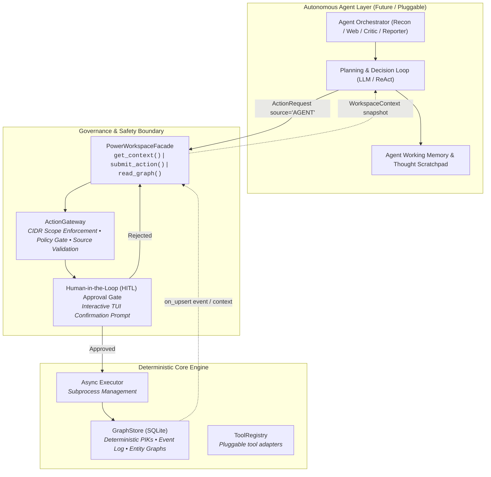
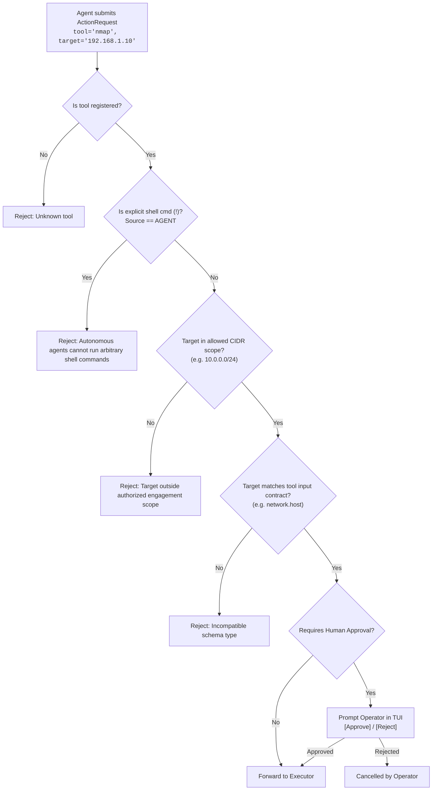

# CyGuide Future: Power Mode as an Autonomous Agent Harness

This document outlines the strategic roadmap and technical architecture for evolving CyGuide from an advanced operator workspace into a fully governed, autonomous cybersecurity agent harness.

The core design principle remains invariant:

> **Keep the CyGuide Core Deterministic.**
> AI agents sit strictly *above* the platform as optional planners and operators—never inside the trusted deterministic core.

---

## 1. High-Level Agent Harness Architecture

CyGuide's architecture isolates AI planning from execution by channeling all agent actions through the same validated programmatic facade used by human operators:



---

## 2. Implementation Progress: Built vs. Future Modules

| Module / Component | Status in Codebase | Implementation Reference |
| :--- | :--- | :--- |
| **`PowerWorkspaceFacade`** | ✅ **Implemented** | [`cyguide/engine/power_facade.py`](file:///home/harsh/Documents/cyguide/cyguide/engine/power_facade.py) |
| **`WorkspaceContext` Model** | ✅ **Implemented** | [`cyguide/schemas/power.py`](file:///home/harsh/Documents/cyguide/cyguide/schemas/power.py) |
| **`ActionRequest` & Typed Actions** | ✅ **Implemented** | [`cyguide/schemas/power.py`](file:///home/harsh/Documents/cyguide/cyguide/schemas/power.py) |
| **`ActionGateway` & Source Gating** | ✅ **Implemented** | [`cyguide/engine/gateway.py`](file:///home/harsh/Documents/cyguide/cyguide/engine/gateway.py) |
| **Universal Variable Substitution** | ✅ **Implemented** | [`PowerWorkspaceFacade.get_context()`](file:///home/harsh/Documents/cyguide/cyguide/engine/power_facade.py#L308-L358) |
| **Reactive Suggestion Engine** | ✅ **Implemented** | [`cyguide/engine/recommendation.py`](file:///home/harsh/Documents/cyguide/cyguide/engine/recommendation.py) |
| **Append-Only Event Sourcing** | ✅ **Implemented** | [`GraphStore.append_event()`](file:///home/harsh/Documents/cyguide/cyguide/engine/store.py#L457-L466) |
| **Portable Session Export/Import** | ✅ **Implemented** | [`GraphStore.export_session()`](file:///home/harsh/Documents/cyguide/cyguide/engine/store.py#L468-L523) |
| **AI Explainer Engine (Ollama/Cloud)** | ✅ **Implemented** | [`cyguide/engine/explainer.py`](file:///home/harsh/Documents/cyguide/cyguide/engine/explainer.py) |
| **Agent Orchestrator Loop** | ⏳ *Planned (Phase 4)* | Autonomous ReAct decision loop |
| **Declarative CIDR Scope Policy** | ⏳ *Planned (Phase 4)* | Automated IP/subnet boundary checker |
| **Multi-Agent Role Coordination** | ⏳ *Planned (Phase 4)* | Specialized subagents (Recon, Web, Reporter) |

---

## 3. The 5 Core Subsystems for Full Autonomy

### 3.1. `PowerWorkspaceFacade` (The Programmatic Boundary)
The facade serves as the single point of entry for both human operators and automated agents:

```python
# Programmatic API exposed to agents:
async def get_context(session_id: str, selected_entity_id: Optional[str] = None) -> WorkspaceContext:
    """Builds a point-in-time snapshot of the target environment and discovered entities."""

async def submit_action(action: ActionRequest) -> UUID:
    """Validates and schedules a tool action through the ActionGateway."""

async def get_graph_snapshot(session_id: str) -> Dict[str, List[Dict]]:
    """Fetches all confirmed findings and relationship edges."""

async def get_proposed_findings(session_id: str) -> List[BaseFinding]:
    """Fetches pending tool recommendations waiting for execution."""
```

> **Invariant**: AI agents never directly interface with SQLite connections, Textual UI widgets, or subprocess pipes.

---

### 3.2. `ActionGateway` & Security Policy Enforcement
Autonomous agents require strict guardrails to prevent unintended lateral movement or out-of-scope scanning:



---

### 3.3. Autonomous Agent Execution Loop (ReAct Architecture)

The future `AgentOrchestrator` will operate via an iterative **Observe $\rightarrow$ Reason $\rightarrow$ Plan $\rightarrow$ Execute $\rightarrow$ Synthesize** cycle:

```mermaid
sequenceDiagram
    autonumber
    participant Agent as AgentOrchestrator
    participant LLM as Planning LLM (Claude/GPT-4o/Ollama)
    participant Facade as PowerWorkspaceFacade
    participant Gateway as ActionGateway
    participant Exec as Async Executor
    participant Store as GraphStore

    loop Autonomous Investigation Cycle
        Agent->>Facade: get_context(session_id)
        Facade-->>Agent: WorkspaceContext (Hosts, Services, Endpoints, EventLog)
        
        Agent->>LLM: Prompt Context + Target Goal + Available Tools
        LLM-->>Agent: Thought: "Discovered port 80; run gobuster to find admin panels"<br>Action: RunTool(tool='gobuster', target='http://10.0.0.1/')
        
        Agent->>Facade: submit_action(ActionRequest(source=AGENT, tool='gobuster', ...))
        Facade->>Gateway: validate_action(ActionRequest)
        Gateway-->>Facade: Policy Approved (In-Scope)
        
        Facade->>Exec: run_tool(...)
        Exec->>Store: upsert_finding(session_id, web.endpoint)
        Exec-->>Facade: Job Completed (Exit Code 0)
        
        Facade-->>Agent: Action Completed & Graph Updated
    end
```

---

### 3.4. Specialized Multi-Agent Roles

Future autonomous operations will divide responsibilities across modular, cooperating subagents:

```text
┌────────────────────────────────────────────────────────────────────────┐
│                        Lead Coordinator Agent                          │
│        • Tracks overall engagement goals and high-level strategy       │
│        • Manages action budget, timeouts, and stop conditions          │
└───────────────────────────────────┬────────────────────────────────────┘
                                    │ delegates
         ┌──────────────────────────┼──────────────────────────┐
         ▼                          ▼                          ▼
┌──────────────────┐       ┌──────────────────┐       ┌──────────────────┐
│   Recon Agent    │       │    Web Agent     │       │  Reporter Agent  │
│ • Netblock CIDR  │       │ • Endpoint fuzz  │       │ • Chronological  │
│ • Host discovery │       │ • Tech profiling │       │   executive sum  │
│ • Port scanning  │       │ • Vuln analysis  │       │ • Risk matrix    │
└──────────────────┘       └──────────────────┘       └──────────────────┘
```

1. **Recon Agent**: Specializes in attack surface mapping (`nmap`, `whois`, `subfinder`), discovering network topologies, and feeding host entities to the graph.
2. **Web Application Agent**: Triggers on confirmed HTTP/HTTPS services, driving `gobuster` and `nikto` to discover endpoints and vulnerabilities.
3. **Critic / Safety Agent**: Continuously audits proposed commands against target scope constraints and execution budgets.
4. **Reporter Agent**: Reads the append-only `event_log` and generates structured Markdown executive summaries.

---

### 3.5. Human-in-the-Loop (HITL) Governance Modes

To balance speed and safety, the agent harness will support three governance operational modes:

| Mode | Description | Safety Level | Target Use Case |
| :--- | :--- | :--- | :--- |
| **`Strict (Step-by-Step)`** | The agent pauses and requests interactive operator confirmation in the TUI before executing every command. | 🟢 Highest | Live production networks, client audits, educational training. |
| **`Bounded Semi-Autonomous`** | The agent executes non-intrusive discovery tools (`nmap -sV`, `whois`, `subfinder`) autonomously; pauses only for active vulnerability scans (`nikto`) or sensitive targets. | 🟡 Balanced | Standard internal penetration tests and CTF challenges. |
| **`Full Autonomous Sandbox`** | Operates autonomously up to a defined action limit or timeout within an isolated subnet. | 🔴 Unrestricted | Automated lab grading and isolated range environments. |

---

## 4. Phase-by-Phase Roadmap to Full Autonomy

```text
[ ✅ Phase 1: Core Foundation ] ── Engine, SQLite Store, PIKs, Schemas, TUI
              │
[ ✅ Phase 2: Facade & Policy ] ── PowerWorkspaceFacade, ActionGateway, Universal Variables
              │
[ ✅ Phase 3: Reactivity & AI ] ── RecommendationEngine, Proposed Nodes, Ollama Explainer
              │
[ ⏳ Phase 4: Agent Runtime ]   ── AgentOrchestrator, Scope Config, HITL Confirmation UI
              │
[ ⏳ Phase 5: Multi-Agent ]     ── Specialized Subagents (Recon, Web, Reporter, Critic)
```

---

## 5. Architectural Invariants Summary

1. **Deterministic Foundation**: The entity graph and event log remain the single source of ground truth—never model hallucination or transient memory.
2. **Identical API Surface**: Autonomous agents use the exact same `PowerWorkspaceFacade` and `ActionRequest` models that power the human Textual TUI.
3. **Source Gating**: Explicit shell commands (`!`) remain restricted to `ActionSource.USER` to prevent arbitrary command injection by language models.
4. **Complete Auditability**: Every prompt, decision rationale, command, and result is recorded immutably in `event_log` for replay and verification.

---

## 6. Related Technical References

* 🏗️ **[System Architecture Blueprint (`docs/developer/ARCHITECTURE.md`)](ARCHITECTURE.md)**: Layered execution pipeline and ADRs.
* 💾 **[Database Architecture & Storage Specification (`docs/developer/DATABASE.md`)](DATABASE.md)**: SQLite relational schema and PIK hashing.
* 📋 **[Schema Registry (`docs/developer/SCHEMA_REGISTRY.md`)](SCHEMA_REGISTRY.md)**: Standard 15-schema finding models.
