# CyGuide User Manual

Welcome to the CyGuide User Manual. This guide provides comprehensive operational instructions for navigating CyGuide's Terminal User Interface (TUI), orchestrating security tools in Power Mode, mastering guided curriculum in Learning Mode, and managing session archives.

---

## 1. Getting Started & The Dashboard

When you launch CyGuide (`cyg`), you enter the **Dashboard Engagement Hub**. The dashboard organizes your investigations into a two-tier hierarchy: **Workspaces** (Projects/Engagements) and **Sessions** (Specific targets or sub-tasks).

```text
┌─────────────────────────┬─────────────────────────────────────────────────┐
│ Workspaces (Ctrl+B)     │ Active Workspace: "Penetration Test Lab"        │
├─────────────────────────┼─────────────────────────────────────────────────┤
│ • Local CTF             │ Sessions:                                       │
│ • Corporate Audit [ACTIVE│ ❯ 10.0.0.1 - Initial Recon (Active: 2 | Closed: 1)│
│ • Staging Environment   │   10.0.0.2 - Web App Assessment                 │
│                         │                                                 │
│ [Ctrl+N] New Workspace  │ Recent Engagement Activity:                     │
│ [Ctrl+S] New Session    │ [14:22] nmap -> Discovered 10.0.0.1:80 (http)   │
│ [F2] Rename | [Ctrl+D]  │ [14:25] gobuster -> Discovered /admin (200 OK)  │
└─────────────────────────┴─────────────────────────────────────────────────┘
```

<p align="center">
  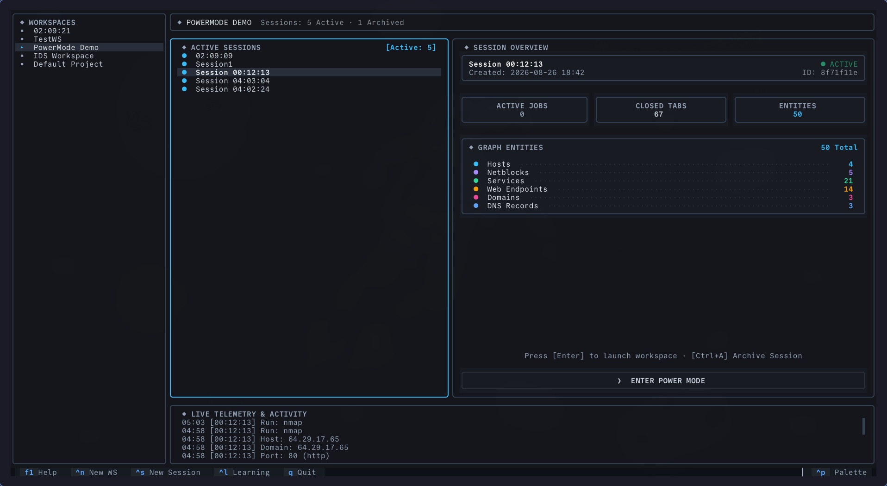
</p>

### Workspace & Session Management
* **Create a Workspace (`Ctrl+N`)**: Prompts for a unique workspace name to isolate an engagement.
* **Create a Session (`Ctrl+S`)**: Creates an investigation session within the highlighted workspace.
* **Launch Power Mode (`Enter`)**: Opens the advanced multi-tab operator workbench for the selected session.
* **Inline Renaming (`F2`)**: Renames the selected workspace or session directly on the dashboard. Names are validated case-insensitively for uniqueness.
* **Organize Sessions (`Ctrl+M`)**: Moves sessions between workspaces without losing graph nodes or execution history.
* **Forensic Archiving (`Ctrl+A`)**: Marks a session as archived (`CLOSED`), enforcing read-only protections against accidental scans while preserving historical data.
* **Delete Cascade (`Ctrl+D`)**: Enters Delete Mode. Selecting items with `Space` and pressing `Ctrl+D` safely cascades deletions through SQLite while terminating running background processes.

---

## 2. Power Mode: Advanced Operator Workbench

Power Mode is an asynchronous terminal IDE designed for multi-target security operations.

<p align="center">
  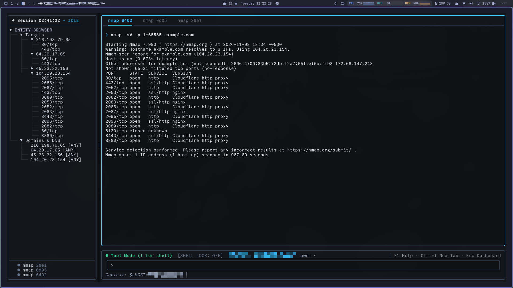
</p>

### Multi-Tab Job Execution
* **New Tab (`Ctrl+T`)**: Spawns an empty terminal tab.
* **Close Tab (`Ctrl+W`)**: Safely terminates the running process (`SIGTERM`) and closes the tab. The closure is persisted to SQLite so finished tabs stay closed across app reboots.
* **Background Process Kill (`Ctrl+K`)**: Terminates the active tab's command without closing the tab.
* **Tab Navigation (`Ctrl+PageUp` / `Ctrl+PageDown`)**: Cycles horizontally across active terminal tabs.
* **Fork Execution (`Shift+Enter` / `Alt+Enter`)**: Executes the command entered in the prompt in a new terminal tab.

### The Entity Browser & Dynamic Resizing
The left pane displays a physical hierarchy of discovered entities:
```text
Targets
└── 192.168.1.10 (Host)
    ├── 22/tcp (ssh)
    └── 80/tcp (http)
        ├── /index.html (Endpoint)
        └── /admin (Endpoint)
```
* **Dynamic Split-Pane Resizing**: Hover over the vertical border (`│`) between panels and drag with the mouse to resize. Panes automatically remember custom widths in `~/.cyguide/settings.json`.
* **Universal Variable Injection**: Clicking any entity node in the tree binds context variables to the status bar:
  * `$TARGET`: IP address or domain of the selected host.
  * `$PORT`: Selected port number (e.g. `80`).
  * `$SERVICE`: Service protocol name (e.g. `http`, `ssh`).
* **Global Entity Graph (`Ctrl+G`)**: Toggles between session-isolated entities and a unified, deduplicated entity graph spanning all sessions in the workspace.

### Contextual Suggestions & Recommendation Engine
The bottom-left pane displays reactive tool recommendations based on discovered findings:
* **Approve Suggestion (`Enter` or Click)**: Pre-populates the prompt with the recommended tool and resolved variables, allowing you to edit flags before execution.
* **Dismiss Suggestion (`d`, `x`, or `Delete`)**: Dismisses the recommendation and removes it from the database.

### Operator Scratchpad (`Ctrl+N`)
Pressing `Ctrl+N` toggles a docked Markdown notes editor. Notes are auto-saved to `~/.cyguide/scratchpad.md` (with private `0o600` permissions), giving you an immediate place for credential notes and investigation thoughts.

### Smart Command Prompt
The prompt supports dual execution modes:
* **Tool Mode (`>`)**: Parsed through CyGuide's adapter framework. Findings are normalized into the entity graph.
* **Raw Shell Mode (`!`)**: Executes arbitrary terminal commands directly through the system shell.
* **Mode Toggle (`> !` or `! !`)**: Switches between Tool and Shell execution.
* **Raw Shell Lock (`Ctrl+L`)**: Locks the prompt in Shell Mode with Tab filename completion.

---

## 3. Learning Mode: Guided Curriculum

Press `Ctrl+L` from the Dashboard to switch to Learning Mode.

<p align="center">
  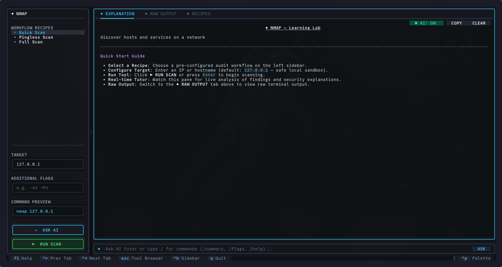
</p>

### 1. Tool Browser
Browse all registered security adapters (`nmap`, `gobuster`, `nikto`, `whois`, `subfinder`):
* Type to filter tools by name, category, or capability.
* Inspect tool recipes, supported inputs, and emitted finding types.
* Press `Enter` on any tool to enter its interactive Lesson Screen.

<p align="center">
  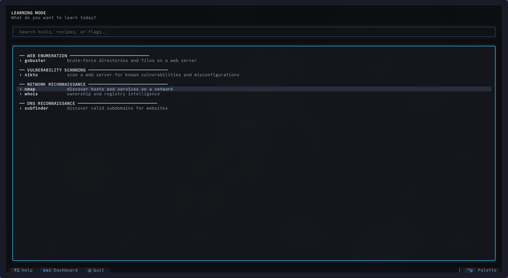
</p>

### 2. Interactive Lesson Screen
* **Recipe Selection**: Choose a pre-configured recipe (e.g. "Pingless Service Scan") to auto-populate flags.
* **Flag & Target Editor**: Interactively customize flags and target parameters with live preview updates.
* **Execution**: Click `RUN` to execute or `STOP` to terminate early.
* **AI Explainer Breakdown**: After execution, the AI tutor synthesizes:
  * Quick Target Summary
  * Discovered Services & Findings Table
  * Detailed Command Flags Breakdown
  * Key Security Takeaways & Hardening Advice
  * Next Recommended Commands
* **AI Tutor Chat**: Use the chat prompt at the bottom right to ask specific questions about output lines or protocols.

---

## 4. Configuration & The Command Palette (`Ctrl+P`)

Press `Ctrl+P` from anywhere in CyGuide to open the Command Palette.

<p align="center">
  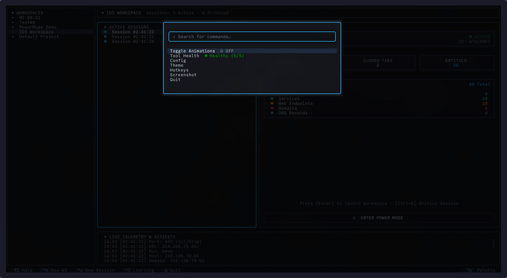
</p>

### Configuration Modal (`Ctrl+Shift+C`)
Access the multi-tab settings panel to customize local models, cloud API providers, databases, and plugins:

#### 1. Local LLM (Ollama)
Enable/disable local inference, set model names (e.g., `llama3`, `gemma`), configure custom endpoints, and run live connection checks:

<p align="center">
  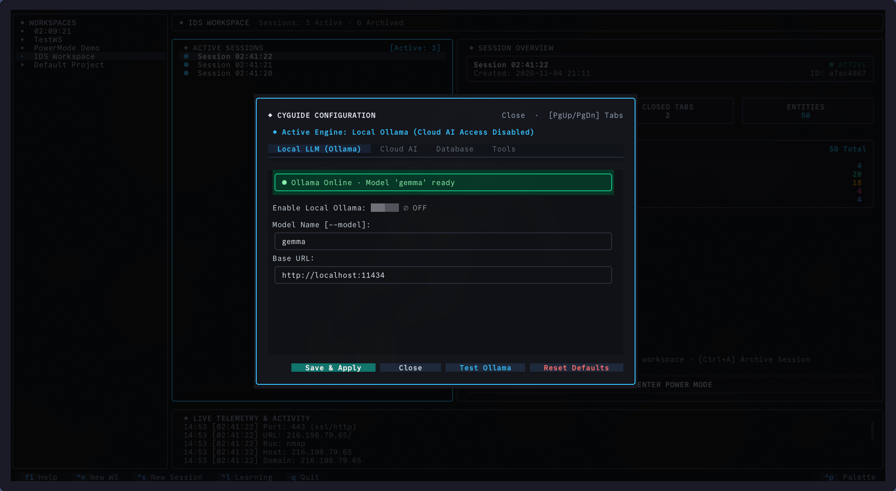
</p>

#### 2. Cloud AI & Multi-Key Profiles
Configure API keys for OpenAI, Anthropic Claude, Groq, OpenRouter, DeepSeek, and Gemini. Set fallback chains to prevent scan interruptions during rate limits:

<p align="center">
  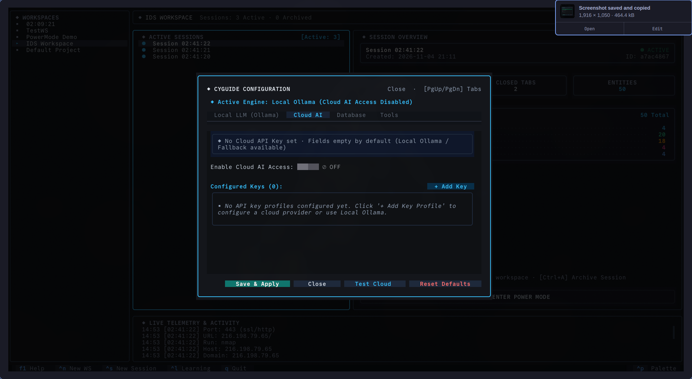
</p>

#### 3. Database Settings
Bind to custom database paths (`--db`) or verify the centralized SQLite store:

<p align="center">
  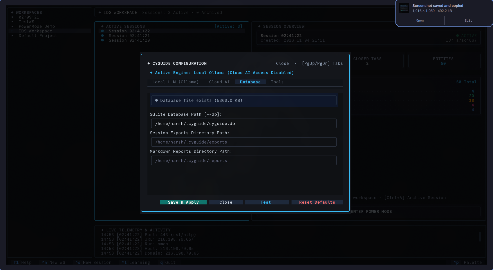
</p>

#### 4. Custom Tools & Plugins
Configure external plugin directories (`--tools`) to load third-party adapters at runtime:

<p align="center">
  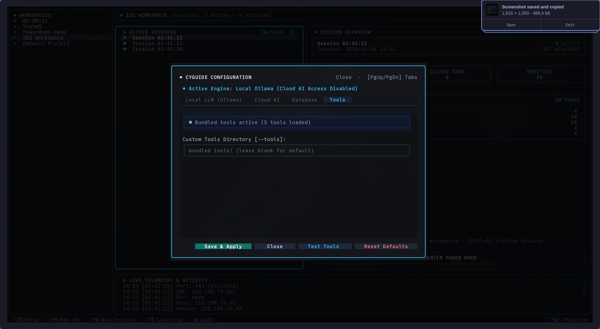
</p>

### Live Tool Health Modal
Select **Tool Health** in the Command Palette to inspect binary availability on PATH (`nmap`, `gobuster`, `nikto`, `subfinder`, `whois`) with exact filesystem paths and package manager installation hints.

<p align="center">
  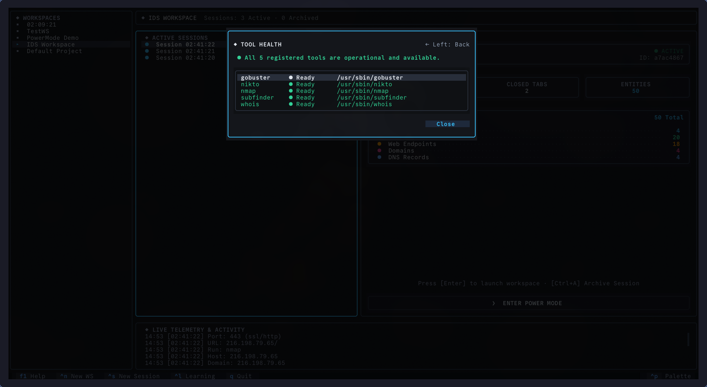
</p>

---

## 5. Session Portability & Reporting

CyGuide provides native capabilities for exporting, archiving, and sharing investigations:

### 1. Machine-Readable Database Exports (`cyg export`)
Export an atomic, self-contained SQLite archive of an investigation session:
```bash
cyg export <session_id> exports/my_session.db
```

Import a session archive into any local CyGuide installation:
```bash
cyg import exports/my_session.db [--workspace-id <target_id>]
```

> [!NOTE]
> Exports use SQLite's zero-copy `ATTACH DATABASE` engine, guaranteeing that finding graphs, edge relationships, and execution logs are copied atomically without data loss.

### 2. Executive & Technical Markdown Reports
Generate formatted Markdown reports summarizing discoveries, open ports, and attack paths:
```bash
cyg export <session_id> exports/my_session.db --report reports/my_session_report.md
```
*(In Power Mode, you can also press `Ctrl+E` to trigger automatic export and reporting).*

---

## 6. CLI Commands & Diagnostics

CyGuide includes dedicated CLI commands and flags for non-interactive diagnostics and automation:

### Version & Help
```bash
# Print installed CyGuide version
cyg --version
cyg -V

# Display command-line usage and subcommands
cyg --help
```

### Diagnostic Health Check (`cyg check`)
Verifies your Python runtime, database write permissions, installed security tools, and AI backends:
```bash
# Human-readable formatted terminal table
cyg check

# Machine-readable JSON output for CI/CD pipelines
cyg check --json
```

### Startup Flags
```bash
# Launch with custom unified data directory
cyg --data-dir /path/to/data

# Launch with custom SQLite database file
cyg --db /path/to/my_database.db

# Launch with local Ollama LLM enabled
cyg --ollama --model mistral

# Launch with custom external tools plugin directory
cyg --tools /path/to/custom_tools
```

---


## 7. Master Keyboard Shortcuts Reference

<p align="center">
  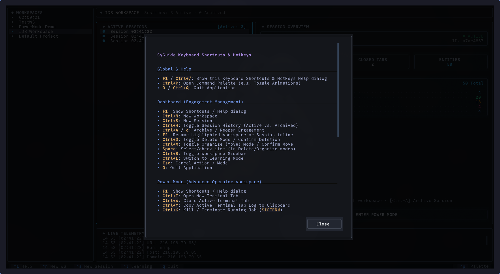
</p>

### Global Shortcuts
| Shortcut | Action |
| :--- | :--- |
| `F1` or `Ctrl+/` | Open Keyboard Shortcuts Help Dialog |
| `Ctrl+P` | Open Command Palette (Configuration, Themes, Tool Health) |
| `Ctrl+Shift+C` | Open In-App Configuration Panel |
| `Q` or `Ctrl+Q` | Quit CyGuide (from Dashboard, Tool Browser, or Lesson Screen) |

### Dashboard Shortcuts
| Shortcut | Action |
| :--- | :--- |
| `Ctrl+N` | Create a new Workspace |
| `Ctrl+S` | Create a new Session in active Workspace |
| `Ctrl+A` | Toggle Archive / Reopen for highlighted Workspace or Session |
| `F2` | Rename highlighted Workspace or Session inline |
| `Ctrl+B` | Toggle left Workspace navigation sidebar |
| `Ctrl+L` | Switch to Learning Mode |
| `Ctrl+D` | Toggle Delete Mode / Confirm deletion |
| `Ctrl+M` | Toggle Organize (Move) Mode / Confirm Move |
| `Space` | Toggle item selection in Delete and Organize modes |
| `Escape` | Cancel Delete or Organize mode |
| `Enter` | Launch Power Mode for highlighted Session |
| `Up` / `Down` | Navigate list items |

### Power Mode Shortcuts
| Shortcut | Action |
| :--- | :--- |
| `Ctrl+T` | Open a new terminal tab |
| `Ctrl+W` | Close active terminal tab (safely terminates running process) |
| `Ctrl+K` | Kill / terminate running process in active tab (`SIGTERM`) |
| `Ctrl+PageUp` | Switch to previous workbench tab |
| `Ctrl+PageDown` | Switch to next workbench tab |
| `Shift+Enter` / `Ctrl+J` | Execute command in a new terminal tab |
| `Ctrl+Tab` / `Ctrl+Right` | Switch to next Session in current workspace |
| `Ctrl+Shift+Tab` / `Ctrl+Left` | Switch to previous Session in current workspace |
| `Ctrl+B` | Toggle sidebar (Entity Browser, Job Queue, Suggestions) |
| `Ctrl+N` | Toggle persistent Markdown Scratchpad |
| `Ctrl+G` | Toggle Global Entity Graph (Session-scoped vs Workspace-wide) |
| `Ctrl+E` | Export session findings (SQLite DB archive & Markdown report) |
| `Ctrl+L` | Toggle Raw Shell Lock mode |
| `Escape` | Exit Power Mode and return to Dashboard |

### Command Prompt & Interaction Shortcuts
| Context | Shortcut | Action |
| :--- | :--- | :--- |
| **Prompt** | `!` prefix | One-time raw shell execution (bypasses tool adapter) |
| **Prompt** | `> !` or `! !` | Quick toggle between Tool (`>`) and Shell (`!`) mode |
| **Prompt** | `Tab` | CWD filename auto-completion (in Shell-Locked mode) |
| **Prompt** | `Up` / `Down` | Navigate command execution history |
| **Suggestions** | `Enter` | Approve recommendation (pre-populates command prompt) |
| **Suggestions** | `d`, `x`, or `Delete` | Dismiss recommendation from queue and database |
| **Entity Tree** | Click / Highlight | Select entity node to bind `$TARGET`, `$PORT`, `$SERVICE` |
| **Job Queue** | Click / Select | Switch to job's terminal tab (auto-swaps active session) |
