# CyGuide User Manual

Welcome to the CyGuide User Manual. This guide provides comprehensive operational instructions for navigating CyGuide's Terminal User Interface (TUI), orchestrating security tools in Power Mode, mastering guided curriculum in Learning Mode, and managing session archives.

---

## 1. Getting Started & The Dashboard

When you launch CyGuide (`cyg`), you enter the **Dashboard Engagement Hub**. The dashboard organizes your investigations into a two-tier hierarchy: **Workspaces** (Projects/Engagements) and **Sessions** (Specific targets or sub-tasks).

```text
┌─────────────────────────┬─────────────────────────────────────────────────┐
│ Workspaces (Ctrl+B)     │ Active Workspace: "Penetration Test Lab"        │
├─────────────────────────┼─────────────────────────────────────────────────┤
│ • Local CTF             │ Sessions:                                       │
│ • Corporate Audit [ACTIVE│ ❯ 10.0.0.1 - Initial Recon (Active: 2 | Closed: 1)│
│ • Staging Environment   │   10.0.0.2 - Web App Assessment                 │
│                         │                                                 │
│ [Ctrl+N] New Workspace  │ Recent Engagement Activity:                     │
│ [Ctrl+S] New Session    │ [14:22] nmap -> Discovered 10.0.0.1:80 (http)   │
│ [F2] Rename | [Ctrl+D]  │ [14:25] gobuster -> Discovered /admin (200 OK)  │
└─────────────────────────┴─────────────────────────────────────────────────┘
```

<p align="center">
  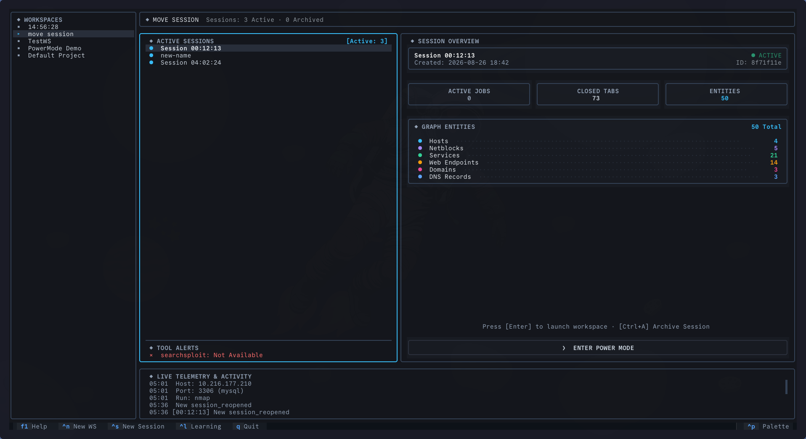
</p>

### Workspace & Session Management
* **Create a Workspace (`Ctrl+N`)**: Prompts for a unique workspace name to isolate an engagement.
* **Create a Session (`Ctrl+S`)**: Creates an investigation session within the highlighted workspace.
* **Launch Power Mode (`Enter`)**: Opens the advanced multi-tab operator workbench for the selected session.
* **Inline Renaming (`F2`)**: Renames the selected workspace or session directly on the dashboard. Names are validated case-insensitively for uniqueness.
* **Organize Sessions (`Ctrl+M`)**: Moves sessions between workspaces without losing graph nodes or execution history.
* **Forensic Archiving (`Ctrl+A`)**: Marks a session as archived (`CLOSED`), enforcing read-only protections against accidental scans while preserving historical data.
* **Delete Cascade (`Ctrl+D`)**: Enters Delete Mode. Selecting items with `Space` and pressing `Ctrl+D` safely cascades deletions through SQLite while terminating running background processes.

---

## 2. Power Mode: Advanced Operator Workbench

Power Mode is an asynchronous terminal IDE designed for multi-target security operations.

<p align="center">
  <a href="../../assets/demo.mp4">
    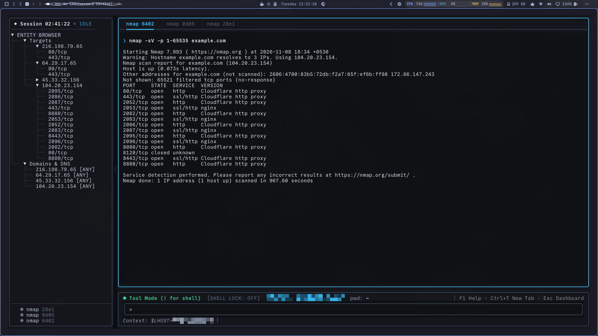
  </a>
  <br>
  <a href="../../assets/demo.mp4">🎬 <b>Watch Power Mode Operator Workbench Video Demonstration (assets/demo.mp4)</b></a>
</p>

### Multi-Tab Job Execution
* **New Tab (`Ctrl+T`)**: Spawns an empty terminal tab.
* **Close Tab (`Ctrl+W`)**: Safely terminates the running process (`SIGTERM`) and closes the tab. The closure is persisted to SQLite so finished tabs stay closed across app reboots.
* **Background Process Kill (`Ctrl+K`)**: Terminates the active tab's command without closing the tab.
* **Tab Navigation (`Ctrl+PageUp` / `Ctrl+PageDown`)**: Cycles horizontally across active terminal tabs.
* **Fork Execution (`Shift+Enter` / `Alt+Enter`)**: Executes the command entered in the prompt in a new terminal tab.

### The Entity Browser & Dynamic Resizing
The left pane displays a physical hierarchy of discovered entities:
```text
Targets
└── 192.168.1.10 (Host)
    ├── 22/tcp (ssh)
    └── 80/tcp (http)
        ├── /index.html (Endpoint)
        └── /admin (Endpoint)
```
* **Dynamic Split-Pane Resizing**: Hover over the vertical border (`│`) between panels and drag with the mouse to resize, or use keyboard shortcuts (`Alt+[` / `Alt+]` for left sidebar, `Ctrl+Alt+[` / `Ctrl+Alt+]` for right sidebar). Sidebars feature buttery-smooth 60 FPS fluid resizing with write-behind persistence and intelligent breakpoint tiers, automatically remembering custom widths in `~/.cyguide/settings.json`.
* **Universal Variable Injection**: Clicking any entity node in the tree binds context variables to the status bar:
  * `$TARGET`: IP address or domain of the selected host.
  * `$PORT`: Selected port number (e.g. `80`).
  * `$SERVICE`: Service protocol name (e.g. `http`, `ssh`).
* **Global Entity Graph (`Ctrl+G`)**: Toggles between session-isolated entities and a unified, deduplicated entity graph spanning all sessions in the workspace.

### Operator Scratchpad (`Ctrl+N`)
Pressing `Ctrl+N` toggles a docked Markdown notes editor. Notes are auto-saved to `~/.cyguide/scratchpad.md` (with private `0o600` permissions), giving you an immediate place for credential notes and investigation thoughts.

### Smart Command Prompt
The prompt supports dual execution modes:
* **Tool Mode (`>`)**: Parsed through CyGuide's adapter framework. Findings are normalized into the entity graph.
* **Raw Shell Mode (`!`)**: Executes arbitrary terminal commands directly through the system shell.
* **Mode Toggle (`> !` or `! !`)**: Switches between Tool and Shell execution.
* **Raw Shell Lock (`Ctrl+L`)**: Locks the prompt in Shell Mode with Tab filename completion.
* **Privileged Execution (`sudo`)**:
  * Execute administrative commands using `!sudo <command>` (or `sudo <command>` in locked shell mode).
  * **Zero-Flicker Cached Execution**: Automatically probes `sudo -n true` first. If credentials/timestamps are already cached, the command runs instantly without interrupting the UI.
  * **Two-Phase Interactive Authentication**: If password entry is required, CyGuide briefly suspends the TUI solely for `sudo -v` in the host terminal to prompt for your password. Once validated, the workbench resumes immediately.
  * **Foreground Live Output Streaming**: The actual command runs with piped standard I/O, streaming its live output line-by-line into the active terminal tab with CTF flag auto-detection, disk log spooling, and persistent session replay.

### Engagement Scope Boundaries (CIDR Enforcement)
* **Scope Guardrails**: All actions executed through CyGuide pass through the `ActionGateway`.
* **Out-of-Scope Protection**: If engagement boundaries are defined (e.g. `10.10.10.0/24`), scanning targets, hostnames, or CLI flags resolving outside the approved CIDR ranges are immediately blocked with a clear `ScopeViolationError`, preventing accidental scans against unauthorized subnets.
* **Cloud Metadata SSRF Defense**: Cloud metadata endpoints (such as `169.254.169.254`, AWS IMDSv2 `fd00:ec2::254`, GCP/Azure metadata) are permanently blocked across all commands and tools.

---

## 3. Learning Mode: Guided Curriculum

Press `Ctrl+L` from the Dashboard to switch to Learning Mode.

<p align="center">
  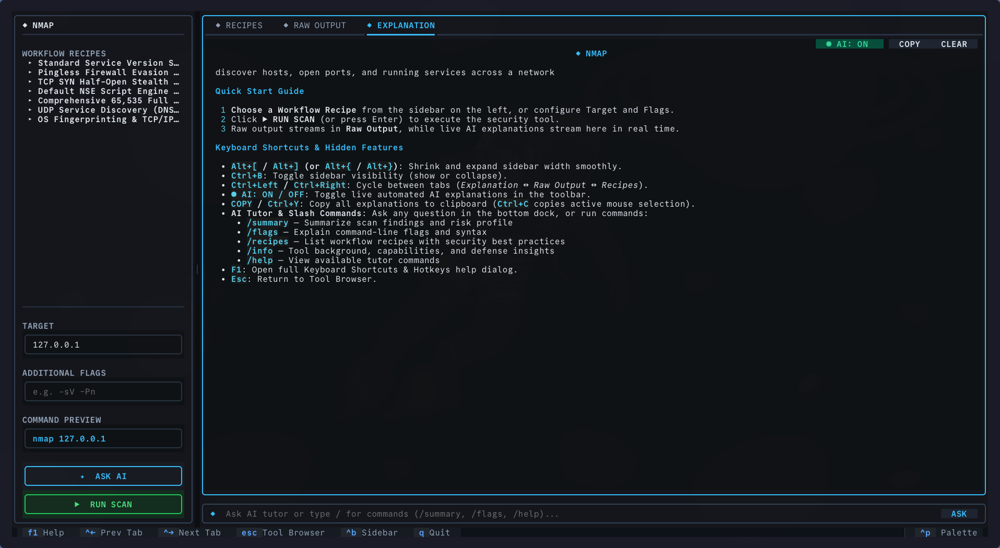
</p>

### 1. Tool Browser
Browse all registered security adapters (`nmap`, `gobuster`, `nikto`, `whois`, `subfinder`, `dnspython`, `searchsploit`, `ffuf`, `nuclei`, `sqlmap`, `netexec`):
* Type to filter tools by name, category, or capability.
* Inspect tool recipes, supported inputs, and emitted finding types.
* Press `Enter` on any tool to enter its interactive Lesson Screen.

<p align="center">
  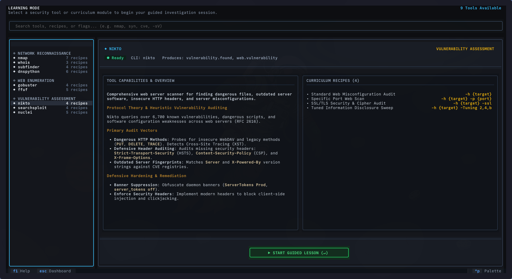
</p>

### 2. Interactive Lesson Screen
* **Recipe Deck (`RecipeDeck`)**: Choose from curriculum-grade pre-configured recipes (e.g. "Pingless Service Scan", "Full Version & Service Detection") with instant execution (`▶ RUN`), flag loading, and targeted flag breakdown queries (`? ASK`).
* **Target & Flag Editor (`FlagEditor`)**: Interactively customize flags, wordlists, and target parameters with live macro substitution (`{target}`, `{url}`, `{domain}`, `{wordlist:...}`).
* **Pre-flight Dependency & Parameter Verification (`PreflightVerifier` / `PreflightModal`)**:
  * Prior to spawning processes, CyGuide validates prerequisite binary presence on system `$PATH`, verifies wordlist files and macro expansions, resolves target variables, and enforces safety bounds (blocking prohibited privilege escalation like `sudo` in Learning Mode and link-local cloud metadata SSRF targets).
  * If missing dependencies or configuration errors are identified, the **Pre-flight Verification Modal** launches automatically with one-click remediation actions (e.g., copying the exact `apt install` command, auto-seeding bundled wordlists, or stripping invalid parameters) before execution proceeds.
* **Target Execution Modes**:
  * **Single Target**: Enter any target IP, domain, or URL in the target field for focused lesson execution.
  * **Database Entity Sweep (`sweep_targets`)**: Programmatically sweep the selected recipe across all targets stored in the database (`GraphStore` nodes including discovered `network.host` IPs, `dns.record` domains, and `web.endpoint` URLs).
* **Execution & Streaming**: Click `RUN` to execute with real-time terminal output streaming (`TerminalStreamPane`) or `STOP` to terminate early.
* **AI Explainer Breakdown**: After execution, the AI tutor synthesizes:
  * Quick Target Summary
  * Discovered Services & Structured Findings Table (auto-correlated from `GraphStore`)
  * Detailed Command Flags Breakdown & Scanner Behavior
  * Key Security Takeaways & Hardening Advice
  * Recommended Next Commands
* **AI Tutor Chat (`stream_tutor_response`)**: Use the interactive chat prompt at the bottom right to ask specific questions about output lines, protocols, or commands. Supports slash commands:
  * `/help`: List all available tutor commands.
  * `/model`: Inspect currently active LLM backend profile and tool context.
  * `/recipes`: View all curriculum recipes for the active tool.
  * `/summary`: Request an on-demand educational summary of the current session.
  * `/flags`: Break down the currently active command flags.
  * `/ai on|off`: Toggle automated AI briefings on scan completion.
  * `/clear`: Clear the explanation pane.

### 3. Universal Multi-Tool Lab Sessions & Checkpoints (`.cyglab`)
Learning Mode operates as a unified investigation across multiple security tools, rather than isolating each tool into separate silos:
* **Tool Switching & Config Caching**: When switching tools (e.g., from `nmap` port discovery to `gobuster` web enumeration or `nikto`), CyGuide automatically caches your custom flags, target, and recipe index in `session.tool_configs`. Returning to a previously configured tool instantly restores your parameters.
* **Unified Graph & Notes**:
  * **Entity Knowledge Graph (`Ctrl+G` / `◈ GRAPH`)**: Discovered security findings across all tools (hosts, open ports, endpoints, vulnerabilities) accumulate into a single shared graph. Toggle between Curriculum Recipes and the live Entity Browser at any time.
  * **Lab Notes & Markdown Export**: Student notes in the right Copilot sidebar persist across all tool switches. Click the **`↓` Export** button in the Notes header to export notes directly into a standalone Markdown report (`exports/notes_*.md`).
* **Lab Checkpoints (`Ctrl+S` / `Ctrl+O`)**:
  * **Save Lab Checkpoint (`Ctrl+S` / `⤓ SAVE`)**: Serializes terminal stdout, all multi-tool graph entities, AI tutor dialogue, student notes, and per-tool configurations into a private `0o600` SQLite `.cyglab` archive (defaults to `lab_{target}_{timestamp}.cyglab`). Badged with `◆ LAB SESSION` or `◆ MULTI-TOOL (N TOOLS)`.
  * **Load Lab Checkpoint (`Ctrl+O` / `⤒ LOAD`)**: Opens the checkpoint browser showing target, tools used (`nmap, gobuster`), discovered findings count, log entries count, and notes preview. Restores the entire multi-tool environment seamlessly.
  * **Reset Lab Session (`Ctrl+Alt+R` / `↻ RESET`)**: Resets all terminal output, entity graphs, AI discussions, and notes back to pristine lab state after a confirmation dialog.

---

## 4. Configuration & The Command Palette (`Ctrl+P`)

Press `Ctrl+P` from anywhere in CyGuide to open the Command Palette.

<p align="center">
  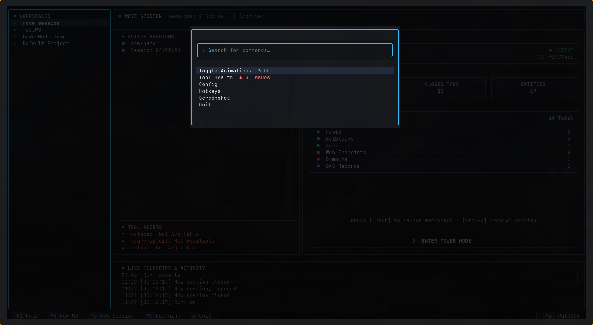
</p>

### Configuration Modal (`Ctrl+Shift+C`)
Access the multi-tab settings panel to customize local models, cloud API providers, databases, and plugins:

#### 1. Local LLM (Ollama)
Enable/disable local inference, set model names (e.g., `llama3`, `gemma`), configure custom endpoints, and run live connection checks:

<p align="center">
  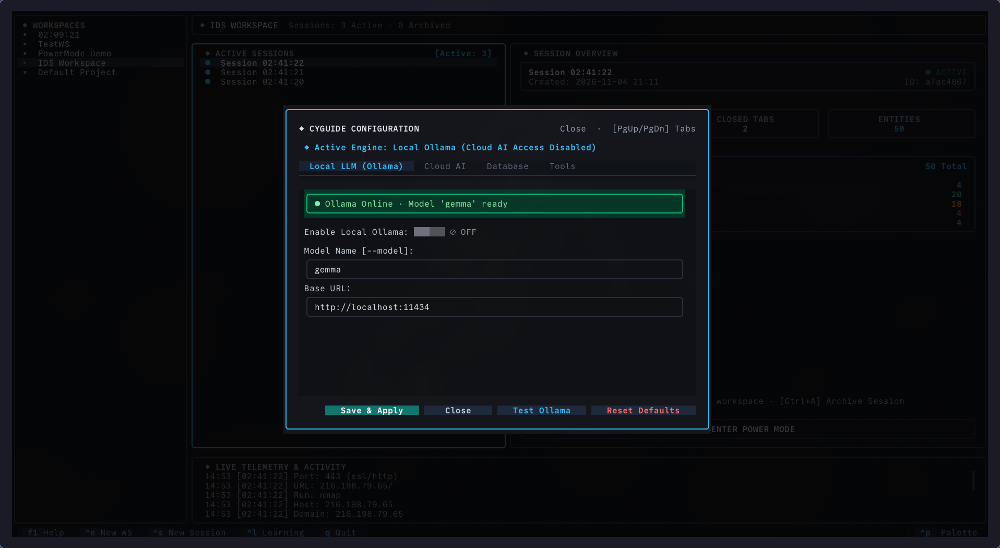
</p>

#### 2. Cloud AI & Multi-Key Profiles
Configure API keys for OpenAI, Anthropic Claude, Groq, OpenRouter, DeepSeek, and Gemini. Set fallback chains to prevent scan interruptions during rate limits:

<p align="center">
  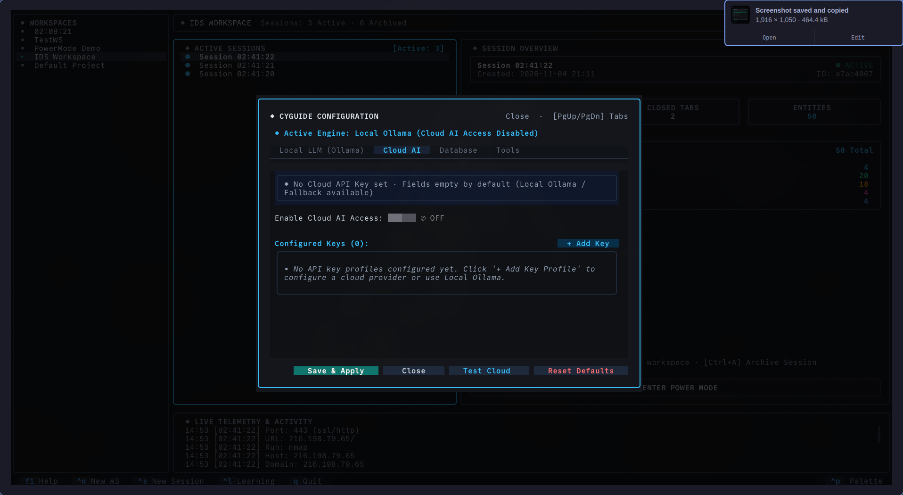
</p>

#### 3. Database Settings
Bind to custom database paths (`--db`) or verify the centralized SQLite store:

<p align="center">
  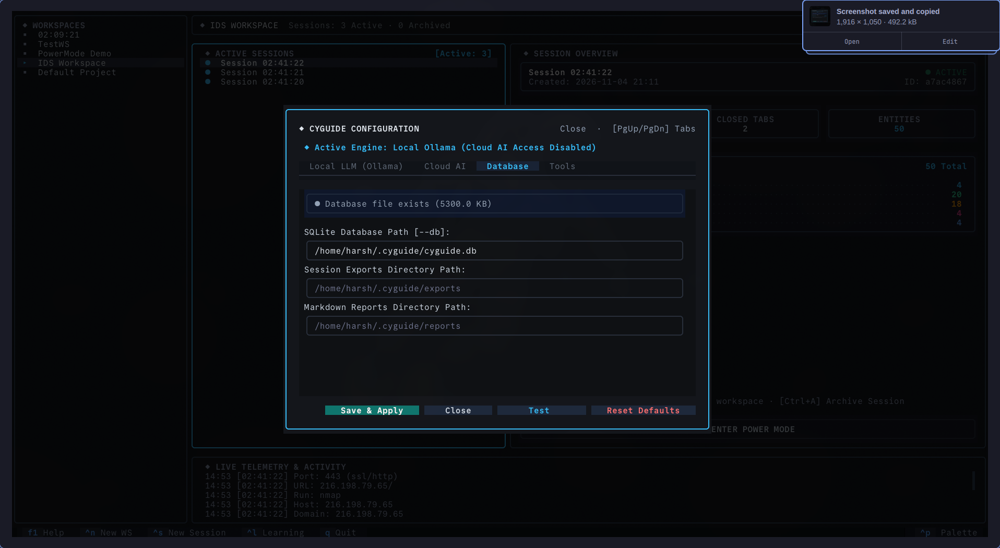
</p>

#### 4. Custom Tools & Plugins
Configure external plugin directories (`--tools`) to load third-party adapters at runtime:

<p align="center">
  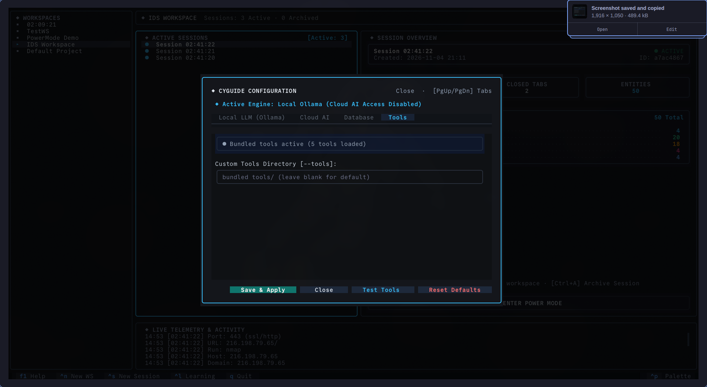
</p>

### Live Tool Health Modal
Select **Tool Health** in the Command Palette to inspect binary and module availability on PATH (`nmap`, `gobuster`, `nikto`, `subfinder`, `whois`, `dnspython`, `searchsploit`, `ffuf`, `nuclei`, `sqlmap`, `netexec`) with exact filesystem paths and package manager installation hints.

<p align="center">
  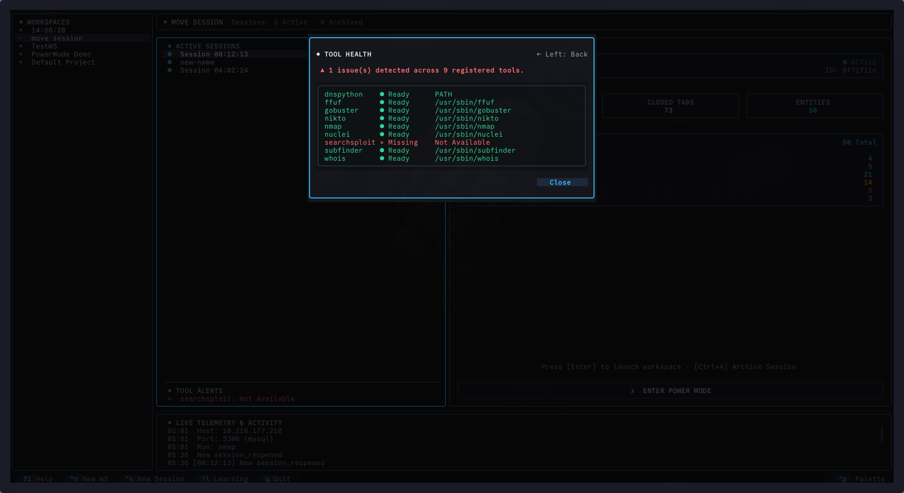
</p>

---

## 5. Session Portability & Reporting

CyGuide provides native capabilities for exporting, archiving, and sharing investigations:

### 1. Machine-Readable Database Exports (`cyg session export`)
Export an atomic, self-contained SQLite archive of an investigation session:
```bash
cyg session export <session_id_or_name> exports/my_session.db
```

Import a session archive into any local CyGuide installation:
```bash
cyg session import exports/my_session.db [-w <workspace_name>]
```

> [!NOTE]
> Exports use SQLite's zero-copy `ATTACH DATABASE` engine, guaranteeing that finding graphs, edge relationships, and execution logs are copied atomically without data loss.

### 2. Executive & Technical Markdown Reports
Generate formatted Markdown reports summarizing discoveries, open ports, and attack paths:
```bash
cyg session export <session_id_or_name> exports/my_session.db -r reports/my_session_report.md
```
*(In Power Mode, you can also press `Ctrl+E` to trigger automatic export and reporting).*

---

## 6. CLI Commands & Diagnostics

CyGuide includes a full domain-driven CLI suite for non-interactive automation, diagnostics, CI/CD pipelines, and offline lab operations:

<p align="center">
  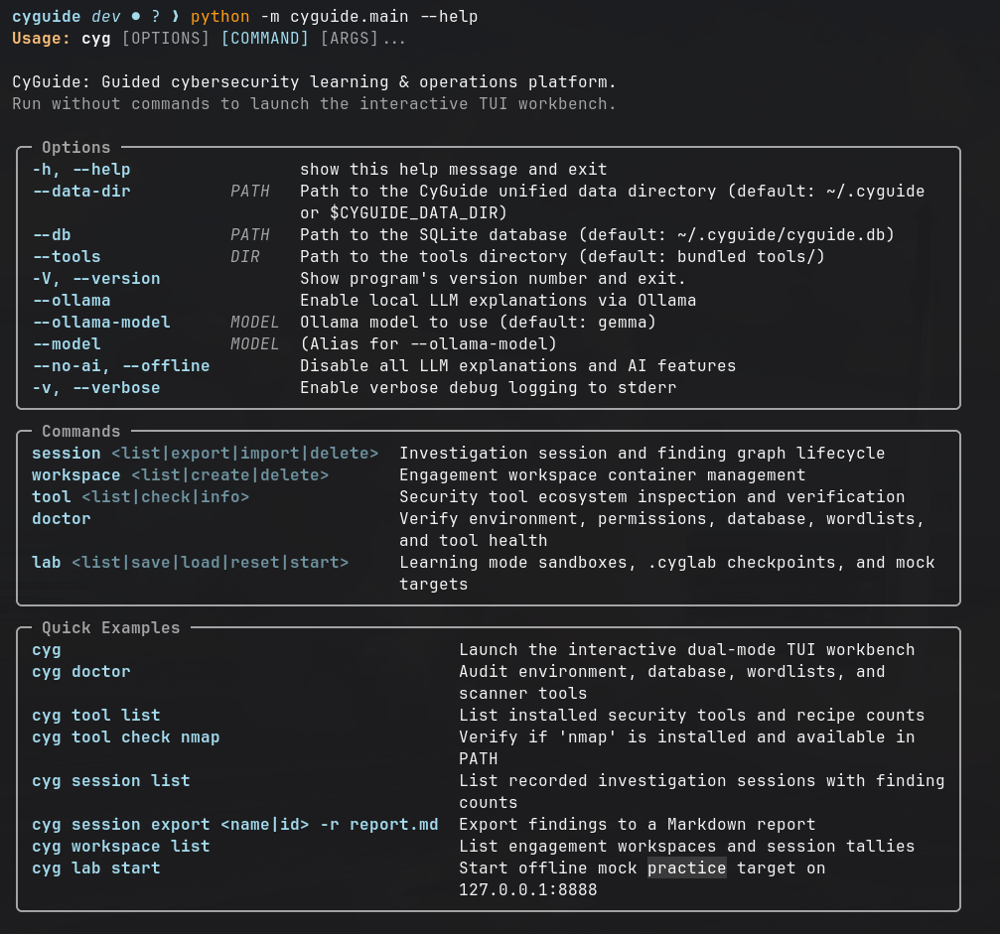
</p>

### Global Options & Version
```bash
# Launch interactive dual-mode TUI workbench
cyg

# Print installed CyGuide version
cyg --version
cyg -V

# Display command-line usage and subcommands
cyg --help

# Startup flags for custom paths and AI modes
cyg --data-dir /path/to/data
cyg --db /path/to/my_database.db
cyg --ollama --model mistral
cyg --tools /path/to/custom_tools
cyg --offline   # Disable all LLM calls
```

### Diagnostic Doctor (`cyg doctor`)
Audit your Python runtime, database write permissions, installed security tools, wordlists, and AI backends:
```bash
# Human-readable formatted terminal table
cyg doctor

# Machine-readable JSON output for CI/CD pipelines
cyg doctor --json
```

### Diagnostic & System Logs (`cyg logs`)
Inspect application runtime logs, filter crash and panic tracebacks with flight recorder breadcrumbs, or clear logs:
```bash
# View the last 50 lines of the centralized system log (~/.cyguide/logs/cyguide.log)
cyg logs

# View the last 100 lines
cyg logs -n 100

# Filter for recent fatal crashes, unhandled exceptions, and UI panics
cyg logs --crashes

# Machine-readable JSON output for automated diagnostics
cyg logs --json

# Truncate and clear the system log
cyg logs --clear
```

### Session Lifecycle & Graph Portability (`cyg session`)
Inspect, export, import, or prune investigation sessions:
```bash
# List all sessions with finding counts & workspaces
cyg session list
cyg session list --workspace-id <ws_id> --json

# Export finding graph to portable SQLite .db
cyg session export "Default Session" exports/my_session.db

# Export findings to portable SQLite .db and compile Markdown report
cyg session export "Default Session" exports/my_session.db -r reports/investigation.md

# Import portable session .db into a workspace
cyg session import exports/my_session.db -w "Engagement-A"

# Delete a session and purge its entity graph
cyg session delete "Old Session" --force
```

### Workspace Container Management (`cyg workspace`)
Create, list, and delete engagement workspaces:
```bash
# List all workspaces with session counts
cyg workspace list

# Create a new engagement workspace
cyg workspace create "Acme Corp Pentest"

# Delete workspace and all its contained sessions
cyg workspace delete "Acme Corp Pentest" --force
```

### Security Tool Ecosystem Inspection (`cyg tool`)
Discover installed security tools, check PATH availability, and review curriculum recipes:
```bash
# List discovered tools, versions, and install status
cyg tool list

# Verify PATH availability across all tools (exits with 127 if missing)
cyg tool check

# Check if a specific binary is installed
cyg tool check nmap

# Display tool schema capabilities and curriculum recipes
cyg tool info nmap
```

### Lab Sandboxes & Checkpoints (`cyg lab`)
Manage universal multi-tool learning sessions and offline CTF mock targets:
```bash
# List saved .cyglab checkpoints
cyg lab list

# Save learning sandbox state to a checkpoint
cyg lab save lesson1 --target 10.10.10.5

# Restore learning sandbox from checkpoint
cyg lab load lesson1.cyglab

# Reset sandbox findings, timeline, and terminal buffers
cyg lab reset --force

# Start embedded offline mock target web server on loopback
cyg lab start --port 8888
```

### Performance Benchmarks & Diagnostic Profiling
Verify system limits, throughput, and 77-branch execution profiles (generates both `docs/benchmarks/README.md` and interactive `docs/benchmarks/preview.html`):
```bash
# Run comprehensive unified benchmark suite and generate Markdown & HTML reports
python scripts/generate_benchmark_report.py

# Verify performance guard thresholds in CI/CD (exits non-zero on regression)
python scripts/generate_benchmark_report.py --check

# Run scale limits only (imports, 500k stream lines, 10k GraphStore nodes, 25k browser entities)
python scripts/generate_benchmark_report.py --skip-branches

# Run standalone 77-branch granular profiling suite (CLI, engine, security, adapters)
python scripts/benchmark_all_branches.py
```

---


## 7. Master Keyboard Shortcuts Reference

<p align="center">
  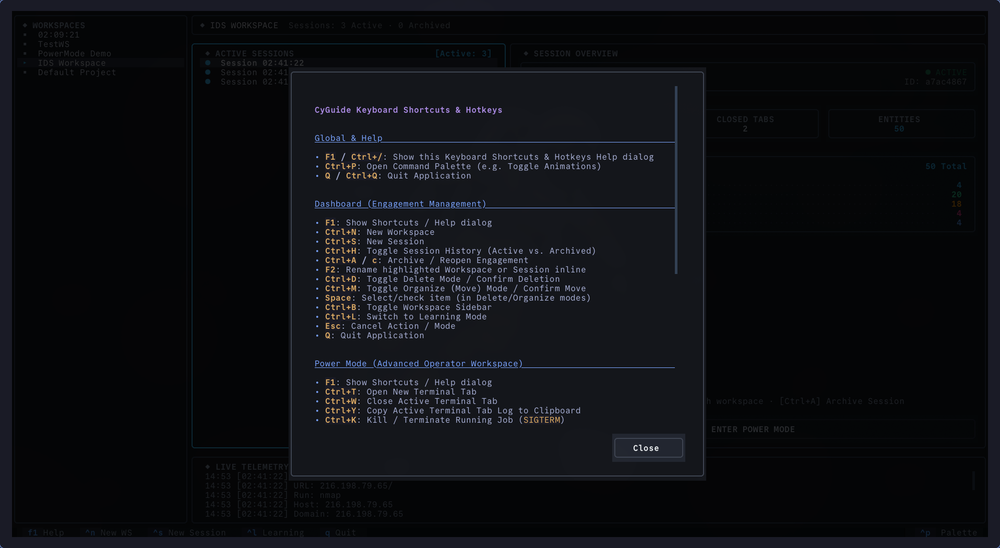
</p>

### Global Shortcuts
| Shortcut | Action |
| :--- | :--- |
| `F1` | Open Keyboard Shortcuts Help Dialog |
| `Ctrl+P` | Open Command Palette (Commands, Settings, Diagnostics, Health) |
| `Ctrl+Shift+C` | Open In-App Configuration Panel |
| `Ctrl+/` | Dismiss active notification toast (one at a time) |
| `Q` or `Ctrl+Q` | Quit CyGuide (from Dashboard, Tool Browser, or Lesson Screen) |

### Command Palette (`Ctrl+P`)
| Shortcut | Action |
| :--- | :--- |
| `Ctrl+P` | Open the Command Palette modal from any screen |
| `Type text` | Fuzzy real-time command search |
| `Up` / `Down` | Navigate matching commands |
| `Enter` or `Right` (`→`) | Execute highlighted command or open Config |
| `Left` (`←`) | Return to parent command list or dismiss modal |
| `PageUp` / `PageDown` | Switch tabs in Configuration dialog (`Ollama` ↔ `Cloud AI` ↔ `Database` ↔ `Tools`) |
| `Escape` | Dismiss Command Palette |

### Dashboard Shortcuts
| Shortcut | Action |
| :--- | :--- |
| `Ctrl+N` | Create a new Workspace |
| `Ctrl+S` | Create a new Session in active Workspace |
| `Ctrl+A` | Toggle Archive / Reopen for highlighted Workspace or Session |
| `F2` | Rename highlighted Workspace or Session inline |
| `Ctrl+B` | Toggle left Workspace navigation sidebar |
| `Ctrl+L` | Switch to Learning Mode |
| `Ctrl+D` | Toggle Delete Mode / Confirm deletion |
| `Ctrl+M` | Toggle Organize (Move) Mode / Confirm Move |
| `Space` | Toggle item selection in Delete and Organize modes |
| `Escape` | Cancel Delete or Organize mode |
| `Enter` | Launch Power Mode for highlighted Session |
| `Up` / `Down` | Navigate list items |

### Learning Mode Dashboard (Tool Catalog)
| Shortcut | Action |
| :--- | :--- |
| `Up` / `Down` | Navigate security tool list (focus starts directly in list) |
| `Right` (`→`) or `Enter` | Launch highlighted tool directly into Learning Mode |
| `Type directly (a-z, 0-9)` | Instant type-to-search (automatically routes to search bar) |
| `Escape` | Single return directly to Dashboard (preserves active tool highlight) |
| `F1` | Open Keyboard Shortcuts Help Dialog |

### Learning Mode (Guided Lesson Screen)
| Shortcut | Action |
| :--- | :--- |
| `Ctrl+S` / `⤓ SAVE` | Save universal lab checkpoint (`.cyglab` SQLite archive) |
| `Ctrl+O` / `⤒ LOAD` | Load saved laboratory checkpoint |
| `Ctrl+Alt+R` / `↻ RESET` | Reset laboratory session (confirmation dialog) |
| `Ctrl+G` | Toggle between Curriculum Recipes and Discovered Entity Knowledge Graph |
| `Ctrl+B` | Toggle left lesson configuration sidebar |
| `Ctrl+Alt+B` | Toggle right AI Copilot pane |
| `Alt+[` / `Alt+]` | Shrink / expand left sidebar width |
| `Ctrl+Alt+[` / `Ctrl+Alt+]` | Expand / shrink right AI Copilot width |
| `Notes Tab (↓)` | Export student notes to formatted Markdown report (`exports/notes_*.md`) |
| `Enter` / `▶ RUN SCAN` | Execute configured tool command |
| `■ STOP SCAN` | Stop currently running tool scan |
| `✦ ASK AI` | Ask AI Tutor to explain active command or workflow recipe |
| `● AI: ON / OFF` | Toggle automated live streaming AI explanations |
| `COPY` / `Ctrl+Y` | Copy explanations or raw terminal output to clipboard (`Ctrl+C` copies mouse selection) |
| `/summary`, `/flags`, `/recipes` | AI Tutor slash commands in bottom dock |
| `Escape` | Return to Tool Browser (preserves active tool highlight) |
| `F1` | Open Keyboard Shortcuts Help Dialog |

### Power Mode Shortcuts
| Shortcut | Action |
| :--- | :--- |
| `Ctrl+T` | Open a new terminal tab |
| `Ctrl+W` | Close active terminal tab (safely terminates running process) |
| `Ctrl+K` | Kill / terminate running process in active tab (`SIGTERM`) |
| `Ctrl+PageUp` | Switch to previous workbench tab |
| `Ctrl+PageDown` | Switch to next workbench tab |
| `Shift+Enter` / `Ctrl+J` | Execute command in a new terminal tab |
| `Ctrl+Tab` / `Ctrl+Right` | Switch to next Session in current workspace |
| `Ctrl+Shift+Tab` / `Ctrl+Left` | Switch to previous Session in current workspace |
| `Ctrl+B` | Toggle sidebar (Entity Browser, Job Queue, Suggestions) |
| `Ctrl+N` | Toggle persistent Markdown Scratchpad |
| `Ctrl+G` | Toggle Global Entity Graph (Session-scoped vs Workspace-wide) |
| `Ctrl+E` | Export session findings (SQLite DB archive & Markdown report) |
| `Ctrl+L` | Toggle Raw Shell Lock mode |
| `Escape` | Exit Power Mode and return to Dashboard |

### Command Prompt & Interaction Shortcuts
| Context | Shortcut | Action |
| :--- | :--- | :--- |
| **Prompt** | `!` prefix | One-time raw shell execution (bypasses tool adapter) |
| **Prompt** | `> !` or `! !` | Quick toggle between Tool (`>`) and Shell (`!`) mode |
| **Prompt** | `Tab` | CWD filename auto-completion (in Shell-Locked mode) |
| **Prompt** | `Up` / `Down` | Navigate command execution history |
| **Entity Tree** | Click / Highlight | Select entity node to bind `$TARGET`, `$PORT`, `$SERVICE` |
| **Job Queue** | Click / Select | Switch to job's terminal tab (auto-swaps active session) |
